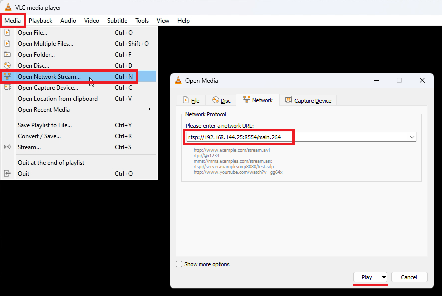
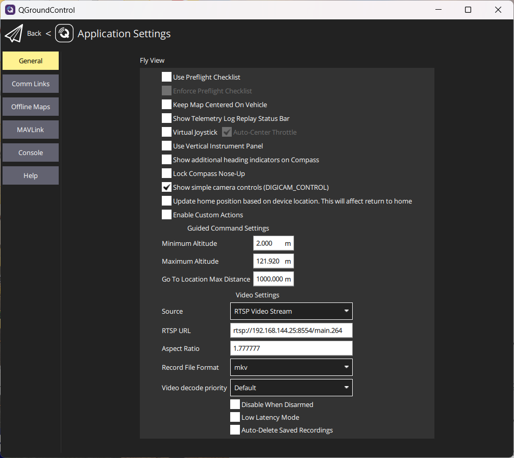

.. _common-ap-camera-gimbal:

[copywiki destination="plane,copter,rover,sub"]

================
AP Camera Gimbal
================

.. image:: https://raw.githubusercontent.com/ArduPilot/AP_CameraGimbal/master/assets/camera-gimbal.svg
    :target: https://github.com/ArduPilot/AP_CameraGimbal
    :width: 150px

`AP Camera Gimbal <https://github.com/ArduPilot/AP_CameraGimbal/blob/master/README.md>`__ is open source software that can be installed and run on these camera gimbals:

- :ref:`Siyi camera gimbals <common-siyi-zr10-gimbal>`
- :ref:`XF Robot Z-1 mini <common-xfrobot-gimbal>`
- RPI CM4 paired with :ref:`XF Robot C-20T <common-caddx-gimbal>` and Sony IMX477 connected via CSI/MIPI

This software has most (but perhaps not all) of the same features as the manufacturer's original software but also includes:

- Recorded video files include the vehicle position and gimbal attitude which allows the `Video Review Tool <https://plot.ardupilot.org/video/>`__ to be used to display side-by-side video and map display
- `Splat Generator <https://plot.ardupilot.org/splat/>`__ allows converting the recorded video into a 3D Gaussian splat
- Live video streaming to the `Support Proxy <https://github.com/ArduPilot/SupportProxy>`__ server

How to Install
--------------

For first time installations:

- Download the appropriate firmware for your camera gimbal from `firmware.ardupilot.org <https://firmware.ardupilot.org/Tools/AP_CameraGimbal/release/>`__
- Follow :ref:`Siyi <common-siyi-zr10-gimbal>` or :ref:`XF Robot <common-xfrobot-gimbal>` firmware update instructions but use the firmware downloaded above

Subsequent upgrades can be done using AP_CameraGimbal's built-in firmware update web page.

The camera gimbal can be reverted to the manufacturer's original software by following the :ref:`Siyi <common-siyi-zr10-gimbal>` or :ref:`XF Robot <common-xfrobot-gimbal>` firmware update instructions.

Configuration
-------------

The autopilot should be configured as per the regular :ref:`Siyi <common-siyi-zr10-gimbal>` or :ref:`XF Robot <common-xfrobot-gimbal>` instructions except for these three parameters:

- :ref:`MNT1_TYPE <MNT1_TYPE>` to 6 (MAVLink)
- :ref:`CAM1_TYPE <CAM1_TYPE>` to 6 (MAVLinkCamV2)
- ``SERIALx_PROTOCOL`` or ``NET_Px_PROTOCOL`` to 2 (MAVLink2) instead of 8 (Gimbal)

Live Video
----------

The video is available using the RTSP URLs shown below.  These URLs assume the camera has been configured with IP address 192.168.144.25

- rtsp://192.168.144.25:8554/video1 (normally RGB)
- rtsp://192.168.144.25:8554/video2 (normally IR/thermal)

If connected to a PC, `VLC <https://www.videolan.org/>`__ can be used to test the feed:

- Open VLC
- Select "Media", "Open Network Stream" and enter the RTSP URL

If using QGC, the live video can be configured from the "Application Settings", "General" screen.  Set "Source" to "RTSP Video Stream" and "RTSP URL" to one of the RTSP URLs listed above.

If using Mission Planner, the live video can be displayed on the Data screen by following :ref:`these instructions <planner:live-video>`.

Control and Testing
-------------------

See :ref:`Gimbal / Mount Controls <common-mount-targeting>` and :ref:`Camera Controls <common-camera-controls>` for details on how to control the camera and gimbal using RC, GCS or Auto mode mission commands.
