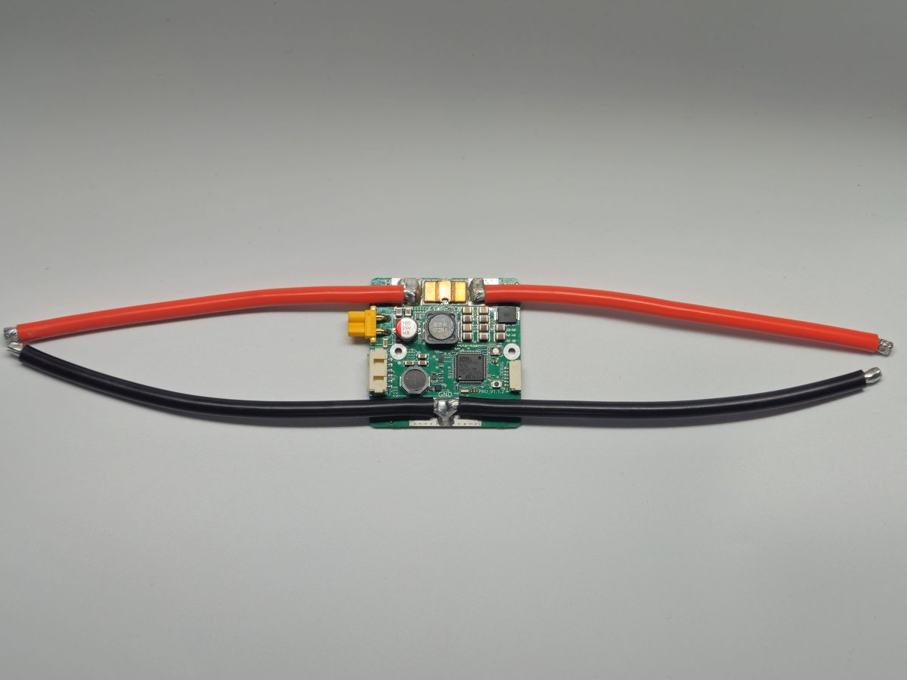

.. _common-csky-gan-pmu:

=====================
CSKY GaN DroneCAN PMU
=====================

The CSKY GaN DroneCAN PMU is a high voltage DroneCAN power module running ArduPilot's AP_Periph firmware. It measures battery voltage, current and temperature, and provides 5V and 12V power outputs.

Specifications
==============

- **Processor:** STM32F412 100MHz, 1024KB Flash, 256KB RAM
- **Voltage Input:** 4S-14S (HV)
- **Continuous Current:** 200A
- **Burst Current:** 300A @ 25°C for 1 sec
- **Max Current Sensing:** 200A
- **Voltage Accuracy:** ±0.05V
- **Current Accuracy:** ±0.7%
- **Temperature Accuracy:** ±1°C
- **Power Port 1 Output (Molex):** 5V/3A
- **Power Port 2 Output (XT30):** 12V/10A
- **Efficiency:** 97% @ 10A
- **Protocol:** DroneCAN
- **Operating Temp:** -25°C ~ +105°C
- **Supports firmware upgrade over CAN**
- **No calibration required**
- **Connector Types:**

  - Power 1 and CAN Port: Molex CLIK-Mate 2mm 6 pin
  - Power 2 Port: XT30PW-F
  - Battery In/Out: tinned wires
- **Physical Dimensions:**

  - Size: 57.5mm x 57.5mm x 17.1mm (not including cables)
  - Weight: 140g (including cables)

Where to Buy
============

`CSKY <https://csky.space/gan_pmu_200>`__

Status LED
==========

- Flashing quickly continuously: in the bootloader, waiting for firmware to be flashed
- Flashing quickly for 3 seconds, then on for 1 second: waiting for CAN connection
- Flashing slowly (one second intervals): CAN connected

Enable the PMU
==============

Connect the PMU's Power 1 and CAN port to the autopilot's CAN port, then set the following parameters and reboot:

- :ref:`CAN_P1_DRIVER<CAN_P1_DRIVER>` to 1 if attached to the CAN1 port, or :ref:`CAN_P2_DRIVER<CAN_P2_DRIVER>` to 1 if attached to the CAN2 port
- :ref:`BATT_MONITOR<BATT_MONITOR>` (or ``BATTx_MONITOR``) to 8 (DroneCAN)

Loading Firmware
================

Firmware for this device can be found `here <https://firmware.ardupilot.org/AP_Periph>`__ in the sub-folder labeled "CSKY_PMU".

The \*.bin firmware can be updated over CAN using the :ref:`DroneCAN GUI tool <common-uavcan-gui>`, or the \*.apj firmware using Mission Planner as explained :ref:`here <planner:dronecan-firmware-flashing>`.
