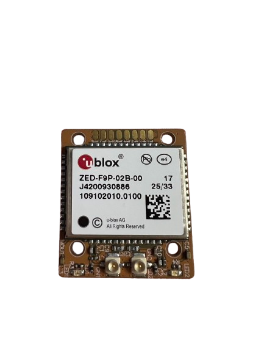
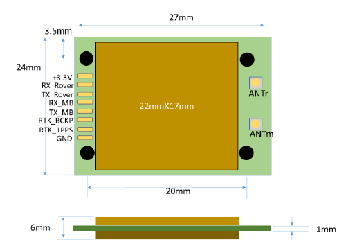

.. _common-gps-navisys-ge920:

===============================
Navisys GE-920 Dual-Antenna RTK
===============================

The Navisys GE-920 is a dual-antenna GNSS module based on the u-blox ZED-F9 RTK engine. It operates simultaneously as an RTK moving base and RTK rover to provide centimeter-level positioning and precise heading without relying on vehicle movement.

Key Features
------------

* **Dual Antenna & Heading:** Integrated u-blox ZED-F9 RTK engine supporting dual I-PEX antenna connectors (Rover & Moving Base) for accurate orientation.
* **Multi-Constellation Dual-Band:** Concurrent L1/L2 reception for GPS, GLONASS, Galileo, BeiDou, QZSS, and SBAS.
* **Centimeter-Level Accuracy:** RTK positioning (0.01 m CEP + 1 ppm) and heading accuracy (<0.4°).
* **Communication Interface:** Dual UART/TTL interfaces (Rover UART and Moving Base UART) at 460800 bps.
* **Compact Form Factor:** 27 x 24 x 6 mm SMD module.

Pinout & Connection Guide
-------------------------

===  ==========  ======================================================  ======
Pin  Name        Function                                                Type
===  ==========  ======================================================  ======
1    +3.3V       3.3V Power Supply (3.3V ± 0.3V)                         Input
2    RX_Rover    UART Receive for Rover                                  Input
3    TX_Rover    UART Transmit for Rover (Outputs RELPOSNED by default)  Output
4    RX_MB       UART Receive for Moving Base                            Input
5    TX_MB       UART Transmit for Moving Base                           Output
6    RTK_BCKP    Backup Power (V_BAT: 3V)                                Input
7    RTK_1PPS    Time Pulse Signal (1PPS)                                Output
8    GND         Ground                                                  Input
===  ==========  ======================================================  ======

.. note::
   Antenna connections: **ANTm** is for Moving Base and **ANTr** is for Rover. Heading is defined as the direction vector from ANTm to ANTr.

ArduPilot Configuration
-----------------------

The GE-920 is used in ArduPilot as a Moving Baseline GPS (see :ref:`common-gps-for-yaw`). Connect the Moving Base UART (pins 4/5) to the autopilot's SERIAL3 port and the Rover UART (pins 2/3) to SERIAL4. Any free serial ports can be used, as long as the parameters below are changed to match. Then set the following parameters:

GPS Driver Settings
~~~~~~~~~~~~~~~~~~~

* :ref:`SERIAL3_PROTOCOL <SERIAL3_PROTOCOL>` = 5 (GPS), Moving Base UART
* :ref:`SERIAL4_PROTOCOL <SERIAL4_PROTOCOL>` = 5 (GPS), Rover UART
* :ref:`GPS1_TYPE <GPS1_TYPE>` = 17 (Moving Baseline Base)
* :ref:`GPS2_TYPE <GPS2_TYPE>` = 18 (Moving Baseline Rover)
* :ref:`GPS_AUTO_CONFIG <GPS_AUTO_CONFIG>` = 1
* :ref:`GPS_AUTO_SWITCH <GPS_AUTO_SWITCH>` = 1 (do not use 2 (Blend) with Moving Baseline)

Dual Antenna Yaw Settings
~~~~~~~~~~~~~~~~~~~~~~~~~

* :ref:`AHRS_EKF_TYPE <AHRS_EKF_TYPE>` = 3 (EKF3)
* :ref:`EK3_SRC1_YAW <EK3_SRC1_YAW>` = 2 (GPS) or 3 (GPS with Compass Fallback)
* :ref:`GPS1_POS_X <GPS1_POS_X>`, :ref:`GPS1_POS_Y <GPS1_POS_Y>`, :ref:`GPS1_POS_Z <GPS1_POS_Z>`: offset of ANTm (Moving Base) from the vehicle's CG.
* :ref:`GPS2_POS_X <GPS2_POS_X>`, :ref:`GPS2_POS_Y <GPS2_POS_Y>`, :ref:`GPS2_POS_Z <GPS2_POS_Z>`: offset of ANTr (Rover) from the vehicle's CG.

See :ref:`common-sensor-offset-compensation` for how to measure these offsets. If the reported heading is reversed, the position offsets are probably set incorrectly.

Where to Buy
------------

* For more details, visit the `Navisys Official Website <https://www.navisys.com.tw/>`_.
