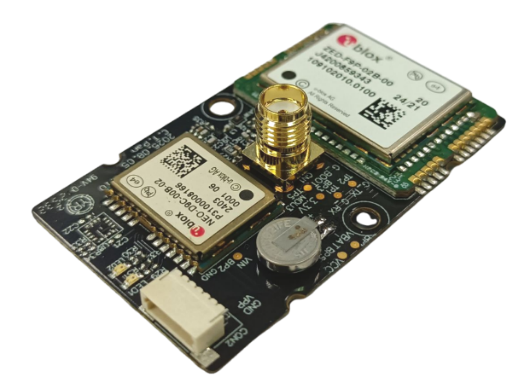
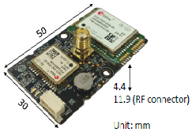
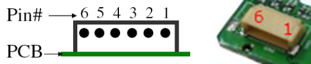

.. _common-gps-navisys-gm-905:

=====================================
Navisys GM-905 RTK / CLAS GNSS Module
=====================================

The Navisys GM-905 is an L1/L2 dual-band RTK GNSS module based on the u-blox ZED-F9P receiver, with an SMA connector for an external helical antenna and a 6-pin UART connector. It is used in ArduPilot with the u-blox GPS driver. Two variants are available:

* **GM-9051 (RTK):** ZED-F9P only. Can be used as an RTK rover with corrections from a ground station, or as a pair for :ref:`Moving Baseline (GPS for Yaw) <common-gps-for-yaw>`.
* **GM-9056 (CLAS):** ZED-F9P plus a u-blox NEO-D9C receiver for the free QZSS CLAS (Centimeter-Level Augmentation Service) L6 signal. This gives centimeter-level positioning without a base station or ground station correction link, inside the CLAS service area (Japan).

Specifications
==============

-  **Receivers**

   - u-blox ZED-F9P dual-band GNSS (all variants)

     - GPS L1C/A L2C, GLONASS L1OF L2OF, Galileo E1-B/C E5b, BeiDou B1I B2I, QZSS L1C/A L1S L2C, SBAS
     - RTK accuracy 0.01 m + 1 ppm CEP (u-blox specification)
     - Update rate up to 7 Hz (PVT, four constellations)
     - RTK convergence in 10 s (multi-GNSS)
     - Spoofing detection and jamming / interference indicator

   - u-blox NEO-D9C QZSS L6 correction receiver (GM-9056 only)

     - CLAS horizontal accuracy 4 cm CEP, vertical 8 cm R50
     - CLAS convergence time < 70 s
     - CLAS update rate up to 5 Hz (four constellations)

-  **Interface**

   - 6-pin, 1.0 mm pitch connector (UART1, UART2 / 1PPS)
   - UART TTL, 460800 bps by default
   - SMA female connector for an L1/L2 (GM-9051) or L1/L2/L6 (GM-9056) helical antenna

-  **Power**

   - 5 V
   - Built-in backup battery

-  **Other**

   - Optional RTK (red) and GNSS (green) status LEDs (suffix L or P)
   - Optional 1PPS output (suffix P)
   - Operating temperature: -40 ~ 85 °C (battery: -10 ~ 60 °C)
   - Dimensions: 30 x 50 x 11.9 mm (including SMA connector)
   - 2 mounting holes

Pinout
======

===  ====  ======================================================  ======
Pin  Name  Function                                                Type
===  ====  ======================================================  ======
1    GND   Ground                                                  Power
2    VCC   Power supply (5 V)                                      Power
3    TXD   UART1 transmit (TTL), to autopilot RX                   Output
4    RXD   UART1 receive (TTL), from autopilot TX                  Input
5    TX2   UART2 transmit, for moving baseline (1PPS on suffix P)  Output
6    RX2   UART2 receive, for moving baseline (NC on suffix P)     Input
===  ====  ======================================================  ======

Connect pins 1 to 4 to a serial (GPS) port of the autopilot. Pins 5 and 6 are only needed for a moving baseline setup with a direct UART2 link (see below).

.. note::
   The GM-905 pin order (GND, VCC, TXD, RXD) is different from the Pixhawk-standard GPS port (5V, TX, RX, SCL, SDA, GND). A custom cable is needed. Connect GM-905 TXD to the autopilot RX and GM-905 RXD to the autopilot TX.

ArduPilot Configuration
=======================

The GM-905 has been tested with ArduPilot by Navisys.

RTK or CLAS Rover (single module)
---------------------------------

When connected to the GPS1 port (SERIAL3) of a Pixhawk-standard autopilot:

* :ref:`SERIAL3_PROTOCOL <SERIAL3_PROTOCOL>` = 5 (GPS)
* :ref:`GPS1_TYPE <GPS1_TYPE>` = 1 (AUTO) or 2 (u-blox)
* :ref:`GPS_AUTO_CONFIG <GPS_AUTO_CONFIG>` = 1 (AutoConfig Serial)

The baud rate is detected automatically, and ArduPilot configures the module for UBX binary output.

**GM-9051:** RTK corrections are sent from the ground station to the module through the autopilot. See :ref:`common-rtk-correction`.

**GM-9056:** CLAS corrections are received and applied inside the module, so no correction link is needed. When CLAS has converged, the GPS status is shown as RTK Float or RTK Fixed. Keep :ref:`GPS1_RATE_MS <GPS1_RATE_MS>` at the default of 200 (5 Hz), which is the maximum CLAS update rate with four constellations.

.. warning::
   On the GM-9056, do not set :ref:`GPS_AUTO_CONFIG <GPS_AUTO_CONFIG>` = 3. This setting clears all receiver configuration not set by ArduPilot, which can remove the factory settings needed for CLAS.

.. note::
   With :ref:`GPS_AUTO_CONFIG <GPS_AUTO_CONFIG>` = 1 and the default :ref:`GPS_SAVE_CFG <GPS_SAVE_CFG>` = 2, ArduPilot changes the UART1 settings of the module (baud rate and UBX output) and saves them to the module. If the module is later used with other software that expects the factory NMEA output, it must be reconfigured, for example with u-center.

Moving Baseline (GPS for Yaw, GM-9051)
--------------------------------------

Two GM-9051 modules can provide GPS yaw as described in :ref:`common-gps-for-yaw`. Connect each module to its own autopilot serial port, for example SERIAL3 and SERIAL4, and set:

* :ref:`SERIAL3_PROTOCOL <SERIAL3_PROTOCOL>` = 5 (GPS)
* :ref:`SERIAL4_PROTOCOL <SERIAL4_PROTOCOL>` = 5 (GPS)
* :ref:`GPS1_TYPE <GPS1_TYPE>` = 17 (u-blox Moving Baseline Base)
* :ref:`GPS2_TYPE <GPS2_TYPE>` = 18 (u-blox Moving Baseline Rover)
* :ref:`GPS_AUTO_CONFIG <GPS_AUTO_CONFIG>` = 1
* :ref:`GPS_AUTO_SWITCH <GPS_AUTO_SWITCH>` = 1 (do not use 2 (Blend) with Moving Baseline)
* :ref:`AHRS_EKF_TYPE <AHRS_EKF_TYPE>` = 3 (EKF3)
* :ref:`EK3_SRC1_YAW <EK3_SRC1_YAW>` = 2 (GPS) or 3 (GPS with Compass Fallback)
* :ref:`GPS1_POS_X <GPS1_POS_X>`/Y/Z and :ref:`GPS2_POS_X <GPS2_POS_X>`/Y/Z: antenna positions of the base and rover modules. See :ref:`common-sensor-offset-compensation`.

By default, the RTCM data from the base module goes to the rover module through the autopilot. Alternatively, connect the UART2 pins of the two modules with a cross-over cable (pin 5 of one module to pin 6 of the other, both ways) and set :ref:`GPS_DRV_OPTIONS <GPS_DRV_OPTIONS>` = 1 so that the RTCM data goes directly over UART2. The UART2 link cannot be used on suffix P modules, because pin 5 is the 1PPS output and pin 6 is not connected.

More Information
================

* `Navisys Official Website <https://www.navisys.com.tw/>`_
