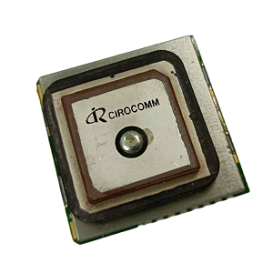
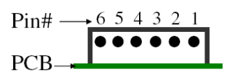

.. _common-gps-navisys-gm-m04b:

=======================================
Navisys GM-M04B L1/L5 GNSS with Compass
=======================================

The Navisys GM-M04B is a compact L1/L5 dual-band GNSS smart antenna module based on the Airoha AG3335 chipset, with an integrated Bosch BMM350 compass. It outputs standard NMEA sentences over UART and is used in ArduPilot with the NMEA GPS driver.

Specifications
==============

-  **Sensors**

   - Airoha AG3335 GNSS (12nm)

     - 135 channels, concurrent L1/L5 dual-band
     - GPS, GLONASS, Galileo, BeiDou, QZSS, NavIC, SBAS
     - Horizontal accuracy 1.5 m CEP (L1+L5)
     - Tracking sensitivity -165 dBm
     - Update rate up to 10 Hz (default 5 Hz)
     - Jamming detection and 12-tone active interference canceller on L1/L5

   - Bosch BMM350 3-axis compass (±2000 μT, I2C)

-  **Interface**

   - 6-pin, 1.0 mm pitch connector (UART TX, ON/OFF control, I2C)
   - UART TTL output, NMEA 0183 (V3.01 / V4.10), 230400 bps by default

-  **Power**

   - 3.3 ~ 5 V, 56 mA (average tracking)
   - Built-in backup battery

-  **Other**

   - Built-in L1/L5 patch antenna
   - Fix status LED (blinking: fixed, on: no fix)
   - Fully EMI shielded
   - Operating temperature: -40 ~ 85 °C (battery: -20 ~ 60 °C)
   - Dimensions: 30 x 30 x 11.8 mm
   - Weight: 19.2 g

Pinout
======

===  =======  ==============================  ======
Pin  Name     Function                        Type
===  =======  ==============================  ======
1    GND      Ground                          Power
2    VCC      Power supply (3.3 ~ 5 V)        Power
3    TXD      UART transmit (TTL)             Output
4    ON/OFF   High/floating: on, low: off     Input
5    SCL      I2C clock (compass)             Input
6    SDA      I2C data (compass)              I/O
===  =======  ==============================  ======

An optional 30 cm cable (6-pin JST-GH to the module connector) is available for direct connection to the 6-pin GPS2 port of Pixhawk-standard autopilots.

.. note::
   Pin 4 is a power ON/OFF control input, not a UART receive line. The module does not accept commands or RTCM corrections from the autopilot. If pin 4 is connected to the autopilot's UART TX line, any data sent on that line pulls the pin low, which may switch the module off. ArduPilot only transmits on the GPS port while detecting the GPS, so the module still works with the default settings, but it may restart during detection. To avoid this, leave pin 4 unconnected, or set :ref:`GPS_AUTO_CONFIG <GPS_AUTO_CONFIG>` = 0 as shown below so that the autopilot does not transmit on this port.

ArduPilot Configuration
=======================

The GM-M04B has been tested on the GPS1 (SERIAL3) and GPS2 (SERIAL4) ports of a Pixhawk 6C. The examples below assume the GPS2 port (SERIAL4). Any free serial port with an I2C bus can be used, as long as the parameters are changed to match.

GPS
---

* :ref:`SERIAL4_PROTOCOL <SERIAL4_PROTOCOL>` = 5 (GPS)
* :ref:`GPS1_TYPE <GPS1_TYPE>` = 5 (NMEA)
* :ref:`GPS_AUTO_CONFIG <GPS_AUTO_CONFIG>` = 0 (Disabled), recommended so that no configuration data is sent to pin 4. This parameter applies to all GPS instances.

.. note::
   The NMEA driver is not included in the automatic detection of ``GPS1_TYPE`` = 1 (AUTO), so ``GPS1_TYPE`` must be set to 5. The baud rate is detected automatically. The module is used with its factory settings (5 Hz, GGA and RMC output).

If another GPS is also connected to a lower-numbered serial port with ``SERIALx_PROTOCOL`` = 5, the GM-M04B becomes the second GPS instance and ``GPS2_TYPE`` should be set to 5 instead.

Compass
-------

The BMM350 compass is detected automatically on the external I2C bus (ArduPilot 4.6 and later). After connecting, perform a :ref:`compass calibration <common-compass-calibration-in-mission-planner>` with :ref:`COMPASS_AUTO_ROT <COMPASS_AUTO_ROT>` enabled so that the orientation of the compass is set automatically. In Navisys testing with the antenna facing up, the detected orientation was :ref:`COMPASS_ORIENT <COMPASS_ORIENT>` = 10 (Roll180Yaw90).

More Information
================

* `Navisys Official Website <https://www.navisys.com.tw/>`_
