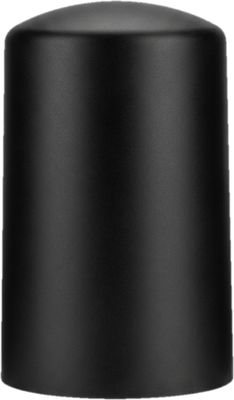
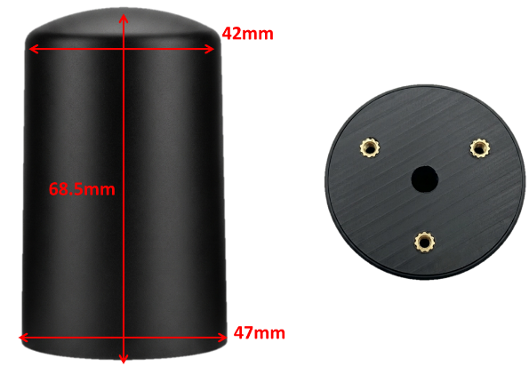

.. _common-gps-navisys-gr-906:

===================================================
Navisys GR-906 RTK Helical Smart Antenna (DroneCAN)
===================================================

The Navisys GR-906 is an all-in-one RTK GNSS smart antenna: a u-blox ZED-F9P dual-band receiver and a helical antenna in one IP67 housing, so no separate antenna or antenna cable is needed. The standard version connects to the autopilot over DroneCAN, with CAN FD up to 8 Mbps available. UART versions are also available.

Variants
========

=======  =====  =========  ==============================================
Model    Bands  Interface  Notes
=======  =====  =========  ==============================================
GR-9060  L1/L2  DroneCAN   Standard version
GR-9068  L1/L5  DroneCAN
GR-9061  L1/L2  UART
GR-9069  L1/L5  UART
GR-9062  L1/L2  2 x UART   Two GR-9061 on a Y-cable, moving baseline pair
=======  =====  =========  ==============================================

Options (suffix, specify when ordering):

* **C:** BMM350 compass (on the DroneCAN versions, the compass is read over CAN; on the UART versions, over I2C)
* **R:** CAN bus termination resistor
* **D:** compass and CAN bus termination resistor
* **F:** CAN FD

Specifications
==============

-  **Receiver**

   - u-blox ZED-F9P dual-band GNSS
   - GPS L1C/A L2C, GLONASS L1OF L2OF, Galileo E1-B/C E5b, BeiDou B1I B2I, QZSS L1C/A L1S L2C, SBAS
   - RTK accuracy 0.01 m + 1 ppm CEP (u-blox specification)
   - Update rate up to 7 Hz (PVT, four constellations)
   - RTK convergence in 10 s (multi-GNSS)
   - Spoofing detection and jamming / interference indicator

-  **Antenna**

   - Built-in helical antenna

-  **Interface**

   - DroneCAN versions: CAN 2.0 at 1 Mbps (default) or 250 kbps, CAN FD up to 8 Mbps (F option)
   - UART versions: UART TTL, 38400 bps by default
   - Waterproof JWPF connector, cable exits from the bottom (custom cable length and connector available)

-  **Compass (optional)**

   - Bosch BMM350, 3-axis, ±2000 μT

-  **Power**

   - 5 V

-  **Other**

   - IP67 waterproof, with internal protection against condensation
   - Operating temperature: -40 ~ 85 °C (GNSS backup battery: -10 ~ 60 °C)
   - Dimensions: Φ42–47 x 68.5 mm
   - 3 mounting screw holes in the bottom

Pinout
======

DroneCAN versions (4-pin):

===  =====  ===================  ======
Pin  Name   Function             Type
===  =====  ===================  ======
1    GND    Ground               Power
2    CAN_L  CAN bus low          I/O
3    CAN_H  CAN bus high         I/O
4    VCC    Power supply (5 V)   Power
===  =====  ===================  ======

UART versions without compass (4-pin):

===  ====  =====================================  ======
Pin  Name  Function                               Type
===  ====  =====================================  ======
1    GND   Ground                                 Power
2    VCC   Power supply (5 V)                     Power
3    TXD   UART transmit (TTL), to autopilot RX   Output
4    RXD   UART receive (TTL), from autopilot TX  Input
===  ====  =====================================  ======

UART versions with compass (6-pin):

===  =======  =====================================  ======
Pin  Name     Function                               Type
===  =======  =====================================  ======
1    GND      Ground                                 Power
2    VCC      Power supply (5 V)                     Power
3    TXD      UART transmit (TTL), to autopilot RX   Output
4    RXD      UART receive (TTL), from autopilot TX  Input
5    I2C_SCL  Compass I2C clock                      Input
6    I2C_SDA  Compass I2C data                       I/O
===  =======  =====================================  ======

.. note::
   The GR-906 pin order is different from the Pixhawk-standard CAN port (5V, CAN_H, CAN_L, GND) and GPS port (5V, TX, RX, SCL, SDA, GND). Use a cable made for the autopilot, or order the GR-906 with a matching cable and connector.

ArduPilot Configuration
=======================

The UART version has been tested with ArduPilot by Navisys.

DroneCAN
--------

Connect the GR-906 to a CAN port of the autopilot (CAN1 in the example below) and set:

* :ref:`CAN_P1_DRIVER <CAN_P1_DRIVER>` = 1 (First driver)
* :ref:`CAN_D1_PROTOCOL <CAN_D1_PROTOCOL>` = 1 (DroneCAN)
* :ref:`GPS1_TYPE <GPS1_TYPE>` = 9 (DroneCAN)

Reboot the autopilot after changing these parameters. See :ref:`common-uavcan-setup-advanced` for more information.

The default CAN bit rate of the GR-906 is 1 Mbps, which is the ArduPilot default (:ref:`CAN_P1_BITRATE <CAN_P1_BITRATE>` = 1000000). For the 250 kbps option, set :ref:`CAN_P1_BITRATE <CAN_P1_BITRATE>` = 250000.

On versions with the compass (C or D option), the compass is detected automatically as a DroneCAN compass. Perform a :ref:`compass calibration <common-compass-calibration-in-mission-planner>` after installation.

The CAN bus must be terminated at each end. Use the R or D option (built-in termination resistor) if the GR-906 is the last node on the bus.

RTK corrections from the ground station are sent to the GR-906 through the autopilot. See :ref:`common-rtk-correction`.

CAN FD (F option)
-----------------

The F option allows CAN FD at up to 8 Mbps, which gives more bandwidth for RTK correction data on a bus shared with other DroneCAN devices. The autopilot must support CAN FD (for example, most H7-based autopilots). In addition to the settings above, set:

* :ref:`CAN_D1_UC_OPTION <CAN_D1_UC_OPTION>` bit 2 (+4) to enable CAN FD
* ``CAN_P1_FDBITRATE`` = 8 (8 Mbps)

See :ref:`CAN FD <dronecan_node_flexibledatarate>` for more information.

UART
----

When the GR-9061 or GR-9069 is connected to the GPS1 port (SERIAL3) of a Pixhawk-standard autopilot:

* :ref:`SERIAL3_PROTOCOL <SERIAL3_PROTOCOL>` = 5 (GPS)
* :ref:`GPS1_TYPE <GPS1_TYPE>` = 1 (AUTO) or 2 (u-blox)
* :ref:`GPS_AUTO_CONFIG <GPS_AUTO_CONFIG>` = 1 (AutoConfig Serial)

The baud rate is detected automatically, and ArduPilot configures the receiver for UBX binary output.

On versions with the compass, connect pins 5 and 6 to the I2C pins of the autopilot GPS port. The BMM350 compass is detected automatically on the external I2C bus (ArduPilot 4.6 and later). Perform a :ref:`compass calibration <common-compass-calibration-in-mission-planner>` with :ref:`COMPASS_AUTO_ROT <COMPASS_AUTO_ROT>` enabled so that the compass orientation is set automatically.

.. note::
   With :ref:`GPS_AUTO_CONFIG <GPS_AUTO_CONFIG>` = 1 and the default :ref:`GPS_SAVE_CFG <GPS_SAVE_CFG>` = 2, ArduPilot changes the UART settings of the receiver (baud rate and UBX output) and saves them to the receiver. If the GR-906 is later used with other software that expects the factory NMEA output, it must be reconfigured, for example with u-center.

More Information
================

* `Navisys Official Website <https://www.navisys.com.tw/>`_
