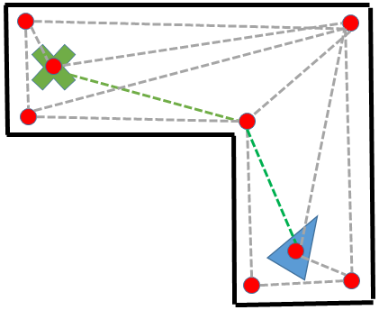

.. _common-oa-dijkstras:

================================
Object Avoidance with Dijkstra's
================================

..  youtube:: GAmNaDTzy3Q
    :width: 100%

Copter and Rover support `Dijkstra's <https://en.wikipedia.org/wiki/Dijkstra%27s_algorithm>`__ for path planning around fences and stay-out zones in Auto, Guided and RTL modes.  This well known algorithm internally builds up a list of "safe areas" calculated from the fence and stay-out zones and then finds the shortest path to the destination.

.. warning::

   Dijkstra's does not support avoiding objects sensed with lidar or proximity sensors

.. warning::

   Dijkstra's does not support Spline Waypoints. 

Configuration
-------------

-  :ref:`OA_TYPE <OA_TYPE>` = 2 (Dijkstra).  You may need to refresh parameters after changing this to see the parameters below.
-  :ref:`OA_MARGIN_MAX <OA_MARGIN_MAX>`: the distance (in meters) that the vehicle should stay away from the fences and stay-out zones
-  :ref:`OA_OPTIONS<OA_OPTIONS>` bit 2 (+4 to the value) can be set to use S-Curves around fence corners in the planned path to speed up turns. Note that using S-Curves, instead of the normal "approach,stop, turn, proceed" method of path planning around sharp fence corners, could still result in a fence breach.To avoid this [site wiki="copter"]:ref:`WP_RADIUS_M<WP_RADIUS_M>`\ [/site][site wiki="rover"]:ref:`WP_RADIUS_M<copter:WP_RADIUS_M>`\ [/site] should be set smaller than :ref:`FENCE_MARGIN<FENCE_MARGIN>`. Also waypoints should also be placed at least 10m from fence boundaries.
[site wiki="copter"]
- For use in :ref:`Guided mode <ac2_guidedmode>`, set :ref:`GUID_OPTIONS<GUID_OPTIONS>` bit 6 (e.g. 64)
[/site]

Vehicle or Destination Outside the Fence
----------------------------------------

Dijkstra's can plan a path when the vehicle or its destination is outside the inclusion fence (in firmware 4.8 and later).

.. note:: Dijkstra's only runs when at least one polygon fence or exclusion circle is loaded. Inclusion circles are ignored if they are the only fences, and are only used alongside a polygon fence or exclusion circle.

- If the straight line from the vehicle to its destination does not cross any fence, it is flown directly, even if both ends are outside the fence. With an inclusion circle fence, the line counts as crossing the fence whenever either end is outside the circle, even if the line itself does not touch it.
- Otherwise, a vehicle outside the fence first flies directly to the closest point inside the fence (the entry point). A destination outside the fence, such as home when the fence was enabled after taking off outside it, is reached by leaving the fence at the point closest to the destination (the exit point) and then flying directly to it.
- Entry and exit points are kept at least :ref:`OA_MARGIN_MAX <OA_MARGIN_MAX>` from every fence edge where possible. If no such point exists, the closest point inside the fence is used even if it is nearer an edge, and if there is none the margin is halved until a point fits.
- The direct legs to the entry point and from the exit point are not planned around stay-out zones. If either crosses a stay-out zone, no path is planned.
- A destination is refused if reaching it means entering a stay-out zone. A vehicle that starts inside a stay-out zone can now leave it, unless the leg to the entry point crosses back into that zone (as it can with a C or U shaped zone) or crosses another one.
- If no path can be planned, the vehicle stops and the ground station shows "Dijkstra: could not find path".

Videos
------

..  youtube:: JKxQGt6XW60
    :width: 100%

[copywiki destination="copter,rover"]
