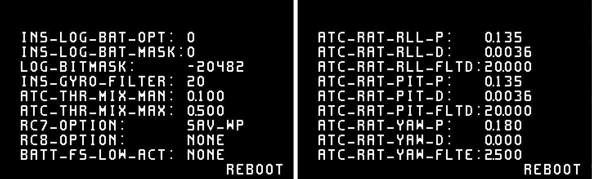
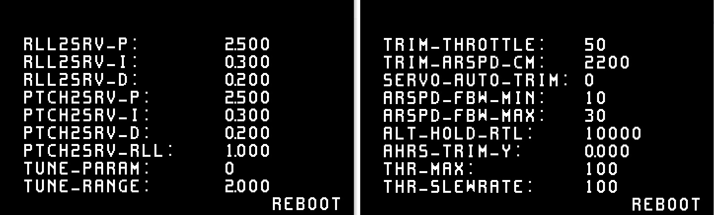
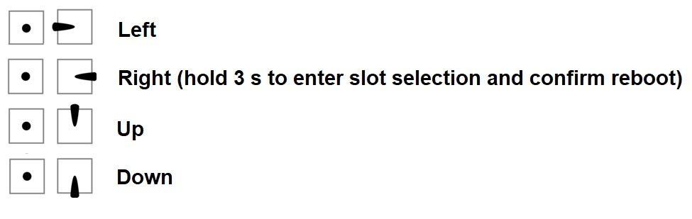
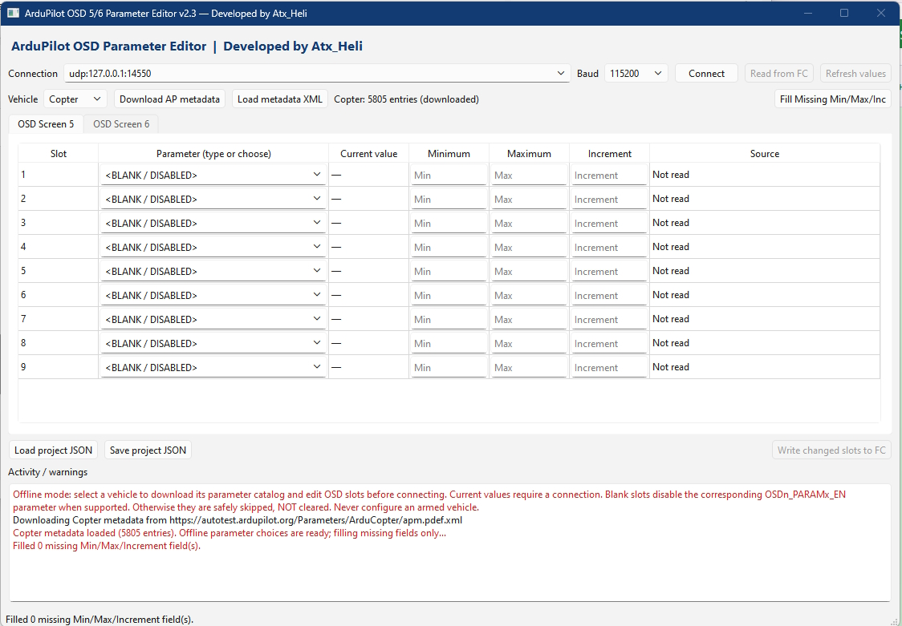
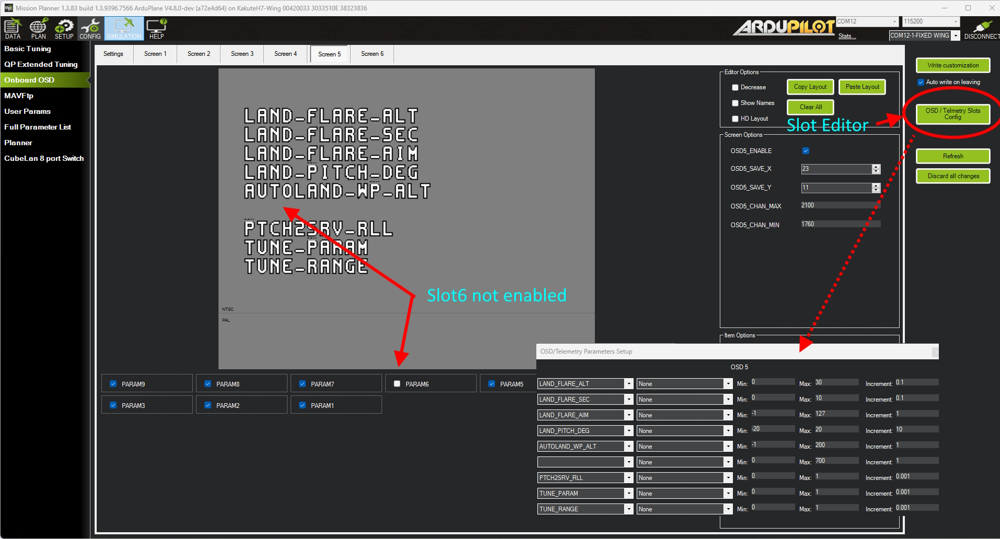

.. _common-paramosd:

========================
OSD based parameter menu
========================

This allows to set and adjust parameters using the ArduPilot onboard OSD and an RC transmitter's stick input. 
There's two additional OSD screens available (OSD5 and OSD6), with 9 "slots" each to hold parameters. The screens 
display a default set of parameters to start with. Additionally, it is possible to change the parameter used in a 
respective slot directly (on-screen) using stick inputs, using the Windows :ref:`ArduPilot OSD Parameter Screens Editor <windows-osd-param-screen-editor>` which can be used whether or not the autopilot is connected to the PC, using Mission Planner's ``OD/Telem Slot Setup`` button on the OSD Screen5 or 6 configuration pages, or using plain text commands in MAVProxy after loading its osd-module. Plane, Copter, and Rover have default parameters pre-setup.

.. note:: OpenTX/EdgeTX CRSF lua scripts allow access to this feature in some radio transmitters.

Copter default screens
======================

Plane default screens
=====================

The RC transmitter's roll and pitch stick input is used to navigate through the screen, pick 
a parameter and adjust the parameter value. Parameter values can be adjusted in disarmed state only. 

Additionally there's a "save and reboot" button on each screen that allows to save the adjusted settings and reboot the 
flight controller if required. It defaults to "reboot", will auto-switch to "save" if a parameter value has been altered, 
and switch back to "reboot" after saving is completed. 

.. note::

   Using the "save" button after adjusting a parameter will make the adjustments persistent, otherwise the value will be reset to its prior state after a reboot.

Accessing parameter screens
===========================

To enable the parameter screens, set :ref:`OSD5_ENABLE <OSD5_ENABLE>` and :ref:`OSD6_ENABLE <OSD6_ENABLE>` = 1.
Parameter screens can be accessed in the same way the conventional osd screens are accessed. 
See the documentation on :ref:`OSD screens and switching <screen-switching>` for reference.
When one of the parameter screens is selected, adjustments can be made in disarmed state only. If a parameter screen is selected inflight, the screen allows display only. This allows live monitoring of automatic parameter adjustments, i.e. when performing autotune procedures or automatic servo trims.

.. note:: For systems not using an actual OSD, as when using CRSF with no OSD or DJI OSD, and running OpenTX transmitters with CRSF configuration script, setting :ref:`OSD_TYPE<OSD_TYPE>` =3 (MSP), will allow the OpenTX CRSF script on the transmitter to change these parameters.

Menu navigation
===============

Use the RC transmitter's roll and pitch input to navigate through the parameter screen. UP / DOWN and LEFT / RIGHT will navigate through 
the OSD screen's parameter slots. The selected parameter will blink. Move right on the selected parameter to adjust its value using 
up or down stick input. Leave the selection with left roll stick input. On a typical mode 2 type transmitter this would be the right 
gimbal stick:

Parameter slot scroll-selection
===============================

Holding roll right for > 3 seconds on a parameter's value will highlight both the selected parameter and its value (blink). This allows 
you to scroll through the full list of parameters and place another parameter into that respective slot using pitch up and down stick input. 
Move left to exit parameter selection and get back into standard screen navigation.

.. note::

   OSD based parameter adjustment is designed to allow basic adjustments without any additional data link or GCS setup required. However, 
   some parameters with exceptionally wide value ranges, as well as complex bitmap-type parameters might not be ideal for adjustment using parameter OSD.

Parameter range, increment and type-mnemonics
=============================================

OSD based parameter menu uses parameter metadata to estimate a useful value range and incrementation for each parameter. Additionally, support for the 
display of human-readable abbreviations instead of numeric values is provided for the following parameter types: 

- flightmodes

- servo functions

- serial protocols

- RC aux options

- failsafe actions

.. note::

   This feature may have limitations on certain parameters with exceptionally wide value ranges and when handling bitmap-type parameters. 

.. _windows-osd-param-screen-editor:

ArduPilot OSD Parameter Screens Editor
======================================

The **ArduPilot OSD Parameter Editor** is a Windows utility for configuring the
user-adjustable parameters displayed on ArduPilot OSD parameter screens 5 and 6.
Each screen supports up to nine parameter slots. The editor provides a graphical
interface for choosing parameters, setting adjustment limits and increments,
and transferring the configuration to a flight controller.

Features
--------

- Can be used when not connected to the autopilot
- Configure up to nine parameter slots on each of OSD screens 5 and 6.
- Search for parameter names using an autocomplete dropdown.
- Load parameter metadata for Plane, Copter, and Rover, including while offline.
- Set minimum, maximum, and increment values for each slot.
- Read existing assignments and display current parameter values when connected.
- Disable individual parameter slots.
- Save and load configurations as JSON files.
- Connect over USB/serial, UDP, or TCP.
- Review status, success, and warning messages in the log window.

Installation
------------
A Windows executable file is located `here <https://firmware.ardupilot.org/Tools/misc/ArduPilot_OSD_ParamScreen_Editor.exe>`__. Download and double click.

Using the Editor
----------------

Select a Vehicle Type
~~~~~~~~~~~~~~~~~~~~~

Choose **Plane**, **Copter**, or **Rover** in the vehicle dropdown. The editor
loads the corresponding published ArduPilot parameter metadata, allowing you to
search for parameters and prepare a configuration without connecting to a flight
controller.

Configure Parameter Slots
~~~~~~~~~~~~~~~~~~~~~~~~~

#. Select **Screen 5** or **Screen 6**.
#. In a slot's parameter dropdown, begin typing a parameter name and select a
   match from the suggestions.
#. Enter the **Min**, **Max**, and **Increment** values. These define the limits
   and step size for adjustments made through the OSD.
#. Repeat for the remaining slots. Select **BLANK / DISABLED** for any slot you
   do not want displayed.
#. Optionally use **Fill Missing Min/Max/Inc** to populate empty fields from
   available metadata.

Connect and Read from the Flight Controller
~~~~~~~~~~~~~~~~~~~~~~~~~~~~~~~~~~~~~~~~~~~

#. Choose the connection method: **USB/serial** (most likely choice if autopilot is connected to PC's USB), **UDP**, or **TCP**.
#. Click **Connect**.
#. Click **Read from FC** to retrieve the current OSD parameter assignments and
   settings. Current flight-parameter values are available when reported by the
   connected controller.

.. warning::

   **Read from FC** replaces the configuration shown in the editor. Save an
   offline configuration to JSON first (see below) if you want to keep it.

Write the Configuration
~~~~~~~~~~~~~~~~~~~~~~~

#. Review the parameter assignments and adjustment ranges.
#. Click **Write to FC** to transfer the configuration.
#. Check the log window for success messages or warnings.
#. Verify the resulting assignments and ranges on the flight controller.

.. note::

   Writing a configuration changes the OSD parameter-slot assignments and their
   adjustment settings. It does **not** directly change the corresponding/underlying flight
   parameter values. Once loaded into the autopilot, use the OSD display screen to actually change
   the parameter values.

Save and Load Configurations
~~~~~~~~~~~~~~~~~~~~~~~~~~~~

Use **Save JSON** to store the displayed configuration for later use. Use
**Load JSON** to reopen a saved configuration, including when preparing settings
offline or configuring another vehicle.

Limitations and Notes
---------------------

- The utility configures parameter screens 5 and 6; it does not edit the entire
  OSD layout.
- The relevant OSD screen must be enabled in ArduPilot for its entries to appear.
- Available parameters and adjustment ranges vary with vehicle type and
  firmware version.
- Published parameter metadata may lag behind development firmware, so some
  parameters may not appear in the offline list for several days after being added/changed.
- Always verify the configuration on the flight controller after writing.

Using Mission Planner to change parameters on the screens
=========================================================
- Go to CONFIG->Onboard OSD->Screen5 or Screen6.
- Enable the screen
- Edit parameters as desired. See below:

Populating a screen's parameter slots using MAVProxy's OSD module
=================================================================
 
OSD based parameter setting includes a `MAVProxy module <https://ardupilot.org/mavproxy/>`__ to populate each screen's parameter slots.
Connect your autopilot, connect tp MAVProxy and load the OSD module by typing :code:`module load osd`

.. note::
   
   The osd module is supported by MAVProxy 1.8.21 and later. Type :code:`pip install --upgrade pymavlink MAVProxy --user` 
   to update MAVProxy if required.

Use the following syntax to set and show a parameter, its type, minimum, maximum and increments:

:code:` osd param-set <screen> <index> <name> (<type> | <min> <max> <increment>)` 

:code:`osd param-show <screen> <index>` 

where 

:code:`screen` is the desired parameter screen number (5 or 6)

:code:`index`  is the desired parameter slot (1 - 9)

:code:`NAME` is the desired parameter's full name (case sensitive)

:code:`type` allows to set mnemonics to 

- :code:`FLIGHT_MODE`
- :code:`SERIAL_PROTOCOL`
- :code:`SERVO_FUNCTION`
- :code:`AUX_FUNCTION` (for RC options)
- :code:`FAILSAFE_ACTION` (plane: battery low and critical failsafe actions; copter: failsafe options)
- :code:`FAILSAFE_ACTION_1` (plane: short failsafe actions; copter: throttle and GCS failsafe options)
- :code:`FAILSAFE_ACTION_2` (plane: long failsafe actions; copter: battery failsafe actions)
- :code:`NONE`

:code:`MIN` allows to set a lower limit to the setteable range

:code:`MAX` allows to limit the settable range's maximum

:code:`INCREMENT` allows to use specific increments if required

Examples
--------

To set OSD5 parameter1 to TRIM_THROTTLE, type :code:`osd param-show 5 1 TRIM_THROTTLE`

To set OSD6 parameter2 to FLTMODE1 using respective mnemonics, type :code:`osd param-set 6 2 FLTMODE1 FLIGHT_MODE`

To set OSD5 parameter2 to LIM_ROLL_CD, limiting range from 2000 - 6000 with increments of 100, type :code:`osd param-set 5 2 LIM_ROLL_CD 2000 6000 100`

To show what OSD6 parameter2 is set to, type :code:`osd param-show 6 2`

.. note::
   
   Be aware that some :code:`TYPE` mnemonic options are vehicle-specific. Make sure to apply mnemonics to the correct vehicle type in order to avoid unexpected results

