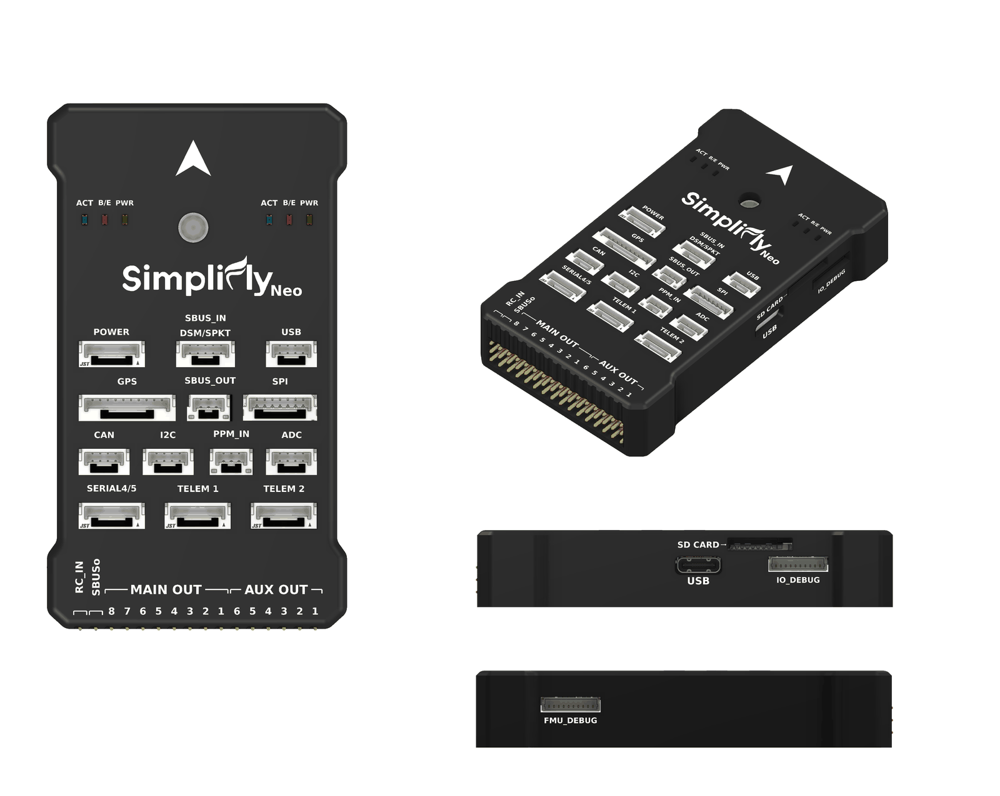

.. _common-simplifly-neo:

=============
Simplifly Neo
=============

The Simplifly Neo is an STM32H753-based autopilot built to the `FMUv6X and
Pixhawk Autopilot Bus open source specifications
<https://github.com/pixhawk/Pixhawk-Standards>`__, with an STM32F103 IO
co-processor, a temperature-controlled IMU and FRAM-backed parameter storage.

.. note:: This board has a **single IMU**. There is no IMU redundancy and the
   EKF runs a single lane. Vehicles that require redundant inertial sensing
   should use a board with multiple IMUs.

Where To Buy
============

Manufactured by `MACFOS LTD <https://www.robu.in>`__ and available from
robu.in and alliance partner portals.

Specifications
==============

-  **Processor**

   -  STM32H753IIK6 (Cortex-M7, 480 MHz, 2 MB flash, 1 MB RAM)
   -  STM32F103 IO co-processor

-  **Sensors**

   -  Bosch BMI088 IMU (accel, gyro)
   -  Bosch BMP390 barometer
   -  Bosch BMM150 magnetometer
   -  Ramtron FRAM for parameter storage

   The IMU carries a regulated heater, defaulting to 45 degrees C. Magnetic
   compensation is applied for the field the heater generates at the BMM150.

-  **Power**

   -  One POWER connector with brick-valid sensing
   -  Valid sensing on the servo rail
   -  INA2xx-based power monitor on I2C bus 1
   -  Independent peripheral and high-power 5 V rails, each with software
      enable and over-current sensing

-  **Interfaces**

   -  7 serial ports (2 USB CDC, 5 on external connectors)
   -  14 PWM outputs
   -  Dedicated SBUS input, PPM input and SBUS output connectors
   -  1x CAN
   -  SPI6 port with two chip selects
   -  3 I2C buses, one brought out to an external connector
   -  microSD card slot
   -  Safety switch with LED, buzzer, RGB status LED
   -  Spektrum / DSM power control

Board
=====

Pinout
======

.. image:: ../../../images/simplifly-neo-connectors.png
    :target: ../_images/simplifly-neo-connectors.png

UART Mapping
============

 - SERIAL0 -> USB (OTG1)
 - SERIAL1 -> UART7 (Telem1) with flow control
 - SERIAL2 -> UART5 (Telem2) with flow control
 - SERIAL3 -> USART1 (GPS1)
 - SERIAL4 -> USART2 (SERIAL4/5 connector)
 - SERIAL5 -> USART3 (SERIAL4/5 connector, also on the FMU debug header)
 - SERIAL6 -> USB (OTG2), MAVLink2

USART6 is reserved for the link to the IO co-processor and is not available as
a serial port.

TELEM1 and TELEM2 carry RTS/CTS. The SERIAL4/5 connector carries TX and RX for
both ports only, with no flow control lines.

RC Input
========

RC input is handled by the IO co-processor, and is brought out in three
places:

 - the RC_IN pin on the output header
 - the PPM_IN connector
 - the SBUS_IN / DSM / SPKT connector, for serial receivers

RC_IN and PPM_IN are the same signal broken out twice for convenience, so
connect a receiver to one or the other, never to both at once.

These inputs handle unidirectional protocols only, such as SBUS, PPM and DSM.
FPort connected here will provide RC without telemetry.

Pin 4 of the SBUS_IN connector carries a switched 3.3V supply for a Spektrum
DSM satellite receiver, enabled at boot. Binding a satellite is supported and is
started from the ground station.

Bi-directional protocols, including CRSF/ELRS, SRXL2 and FPort with telemetry,
require a full UART with ``SERIALx_PROTOCOL`` set to "23". For example, using
SERIAL4 on the SERIAL4/5 connector:

 - :ref:`SERIAL4_PROTOCOL<SERIAL4_PROTOCOL>` = 23
 - FPort requires :ref:`SERIAL4_OPTIONS<SERIAL4_OPTIONS>` = 15
 - CRSF/ELRS requires :ref:`SERIAL4_OPTIONS<SERIAL4_OPTIONS>` = 0
 - SRXL2 requires :ref:`SERIAL4_OPTIONS<SERIAL4_OPTIONS>` = 4, and connects
   only the TX pin

Any UART can be used for RC in ArduPilot, and is compatible with all protocols
except PPM. See :ref:`common-rc-systems` for details.

PWM Output
==========

The Simplifly Neo has 14 PWM outputs. The output header carries 16 pins.
Viewed from above with the forward arrow pointing away from you, they read
left to right: RC_IN, SBUS_OUT, M8 down to M1, then A6 down to A1.

 - M1 to M8 are driven by the IO co-processor and are ArduPilot outputs
   SERVO1 to SERVO8
 - A1 to A6 are driven by the FMU and are ArduPilot outputs SERVO9 to SERVO14

Because the main outputs M1 to M8 are the first eight ArduPilot outputs, a
standard multicopter motor layout maps to M1 to M8 directly.

All 14 outputs support DShot. Bi-directional DShot is available on the IOMCU
outputs, M1 to M8.

The 6 FMU outputs are in 2 groups:

 - Outputs 9, 10, 11 and 12 (A1 to A4) in group1
 - Outputs 13 and 14 (A5 and A6) in group2

FMU outputs within the same group need to use the same output rate and
protocol. If any output in a group uses DShot then all channels in that group
need to use DShot.

Battery Monitoring
==================

The board has an INA2xx power monitor on the POWER connector, set up by
default:

- :ref:`BATT_MONITOR<BATT_MONITOR>` = 21

.. note:: do not use the Mission Planner SETUP->Optional Hardware->Battery
   Monitor tab to set up the I2C power monitor. The parameters needed for its
   operation are already set by default.

Compass
=======

The Simplifly Neo has a built-in BMM150 compass. Due to potential interference,
and because the board's IMU heater sits close to it, the autopilot is normally
used with an external compass as part of a GPS/Compass combination.

GPIOs
=====

The 6 FMU outputs can be used as GPIOs (relays, buttons, RPM etc). To use them
set the output's ``SERVOx_FUNCTION`` to -1. See the :ref:`common-gpios` page
for more information.

The numbering of the GPIOs for PIN variables in ArduPilot is:

 - A1 (SERVO9)  50
 - A2 (SERVO10) 51
 - A3 (SERVO11) 52
 - A4 (SERVO12) 53
 - A5 (SERVO13) 54
 - A6 (SERVO14) 55

Additional GPIOs:

 - NFC_GPIO 60, a spare input on the FMU debug header

Analog inputs
=============

The ADC connector has two analog inputs, one 6.6 V tolerant and one 3.3 V
tolerant:

 - ADC Pin12 -> ADC 6.6V Sense
 - ADC Pin13 -> ADC 3.3V Sense

Use these numbers for :ref:`BATT_VOLT_PIN<BATT_VOLT_PIN>`,
:ref:`BATT_CURR_PIN<BATT_CURR_PIN>`, :ref:`ARSPD_PIN<ARSPD_PIN>` and
:ref:`RSSI_ANA_PIN<RSSI_ANA_PIN>`.

The RSSI_IN pin on the SBUS_IN connector is sampled by the IOMCU. To use it set
:ref:`RSSI_TYPE<RSSI_TYPE>` = 1 and :ref:`RSSI_ANA_PIN<RSSI_ANA_PIN>` = 103.

Connectors
==========

Unless noted otherwise all connectors are JST GH.

The safety switch, its LED and the buzzer are all on the GPS connector rather
than on a connector of their own.

Loading Firmware
================

The board comes pre-installed with an ArduPilot compatible bootloader,
allowing the loading of xxxxxx.apj firmware files with any ArduPilot compatible
ground station.

Firmware for this board can be found `here <https://firmware.ardupilot.org>`_
in sub-folders labeled "SimpliflyNeo".

More information
================

`MACFOS / robu.in <https://www.robu.in>`__.

[copywiki destination="plane,copter,rover,blimp,sub"]
