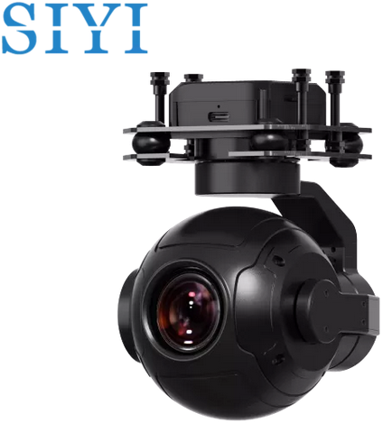
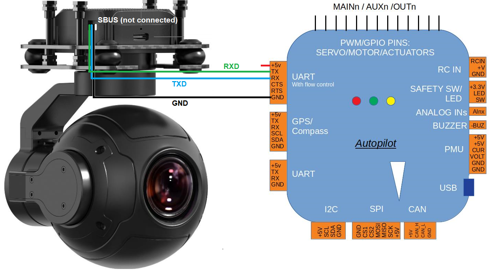
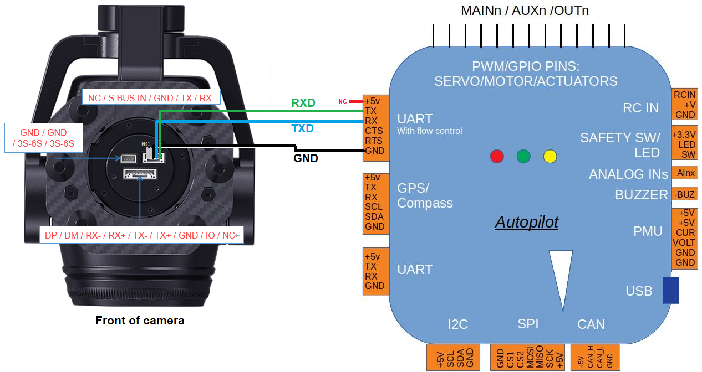
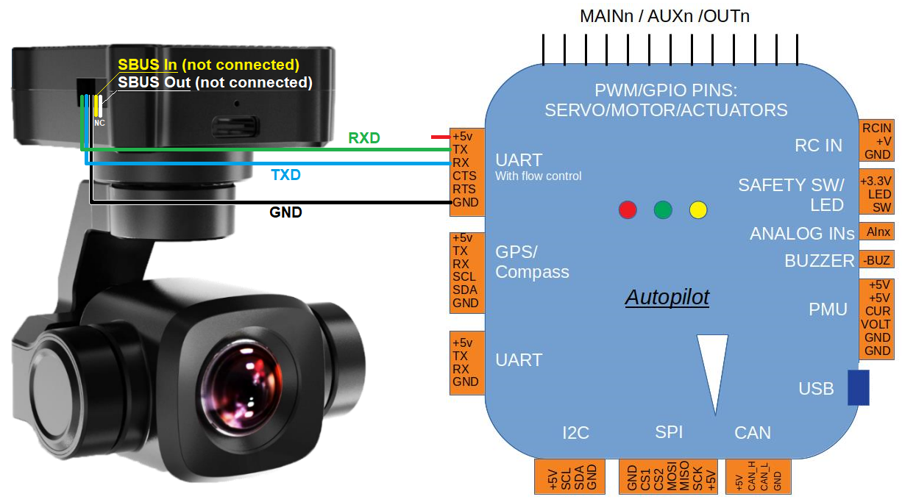
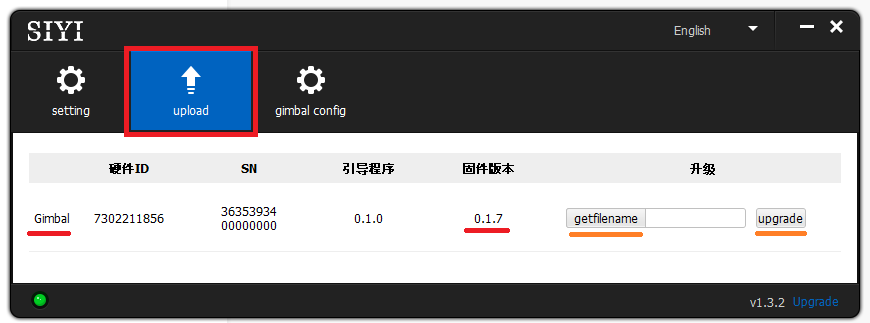
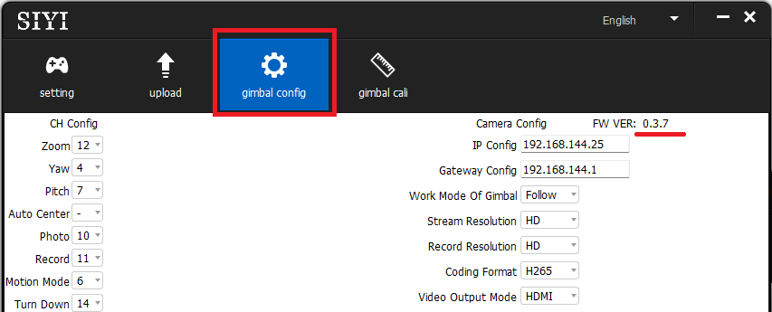
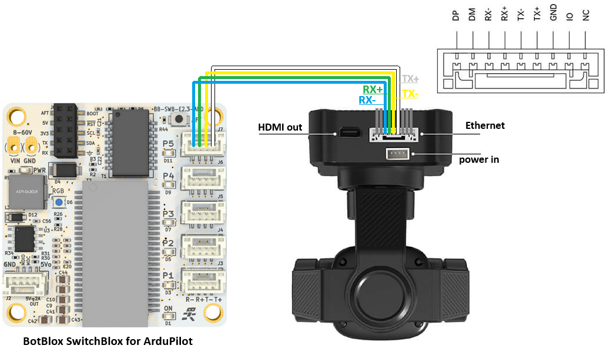
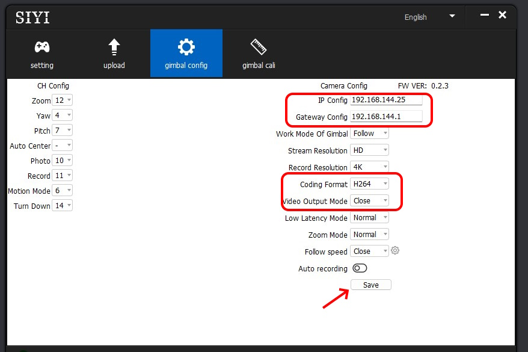
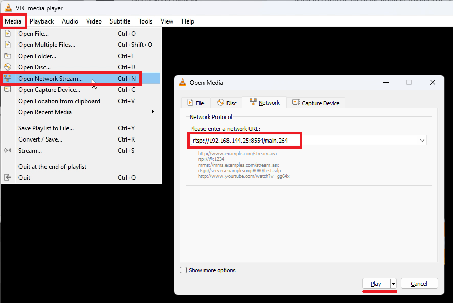
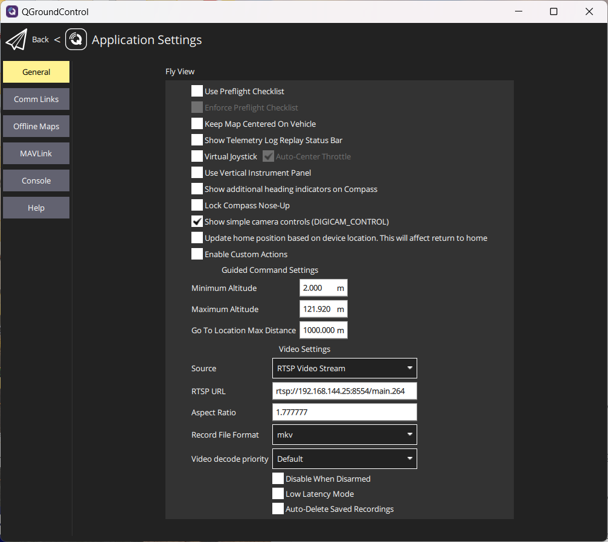

.. _common-siyi-zr10-gimbal:

[copywiki destination="plane,copter,rover,sub"]

===================
SIYI Camera Gimbals
===================

Siyi manufactures a range of camera gimbals that are compatible with ArduPilot using a custom protocol via serial or Ethernet.  The lineup includes:

- `SIYI A8 <https://shop.siyi.biz/products/siyi-a8-mini-gimbal-camera>`__
- `SIYI ZR10 <https://shop.siyi.biz/products/siyi-zr10-gimbal-camera>`__
- `SIYI ZR30 <https://shop.siyi.biz/products/zr30-4k-8mp-ultra-hd-180x-hybrid-30x-optical-gimbal-camera>`__
- `SIYI ZT6 <https://siyi.biz/en/index.php?id=602>`__
- `SIYI ZT30 <https://shop.siyi.biz/products/siyi-zt30>`__

.. warning::

    The Siyi A2 is not supported.

Where to Buy
------------

These gimbals can be purchased directly from `SIYI <https://shop.siyi.biz/collections/gimbal-camera>`__

Connecting to the Autopilot
---------------------------

Connect the gimbal's RX, TX and GND pins to one of the autopilot's serial ports as shown above.

Connect with a ground station and set the following parameters.  The params below assume the autopilot's telem2 port is used and the Camera1 control instance:

- :ref:`SERIAL2_PROTOCOL <SERIAL2_PROTOCOL>` to 8 ("SToRM32 Gimbal Serial")
- :ref:`SERIAL2_BAUD <SERIAL2_BAUD>` to "115" for 115200 bps
- :ref:`MNT1_TYPE <MNT1_TYPE>` to "8" ("Siyi") and reboot the autopilot
- :ref:`MNT1_PITCH_MIN <MNT1_PITCH_MIN>` to -90
- :ref:`MNT1_PITCH_MAX <MNT1_PITCH_MAX>` to 25
- :ref:`MNT1_YAW_MIN <MNT1_YAW_MIN>` to -135
- :ref:`MNT1_YAW_MAX <MNT1_YAW_MAX>` to 135
- :ref:`MNT1_RC_RATE <MNT1_RC_RATE>` to 90 (deg/s) to control speed of gimbal when using RC targeting
- :ref:`RC6_OPTION <RC6_OPTION>` = 213 ("Mount Pitch") to control the gimbal's pitch angle with RC channel 6
- :ref:`RC7_OPTION <RC7_OPTION>` = 214 ("Mount Yaw") to control the gimbal's yaw angle with RC channel 7
- :ref:`RC8_OPTION <RC8_OPTION>` = 163 ("Mount Yaw Lock") to switch between normal yaw operation and locking mount heading with RC channel 8 (in RC Targeting mode only).
- :ref:`CAM1_TYPE<CAM1_TYPE>` = 4 / "Mount (Siyi)" to allow control of the camera
- Optionally these auxiliary functions are also available:

  - :ref:`RC9_OPTION <RC9_OPTION>` = 9 ("Camera Trigger") to take a picture
  - :ref:`RC9_OPTION <RC9_OPTION>` = 166 ("Camera Record Video") to start/stop recording of video
  - :ref:`RC9_OPTION <RC9_OPTION>` = 167 ("Camera Zoom") to zoom in and out
  - :ref:`RC9_OPTION <RC9_OPTION>` = 168 ("Camera Manual Focus") to adjust focus in and out
  - :ref:`RC9_OPTION <RC9_OPTION>` = 169 ("Camera Auto Focus") to trigger auto focus

.. warning::

    A8 does not support zoom at 4K recording resolution

Firmware Updates and Configuration
----------------------------------

Ensure the camera gimbal is running a recent firmware:

- Download, install and run "SIYI PC Assistant" which can be found on any of the links below.  Also download the "Firmware Pack" which includes the latest firmware for the camera and gimbal

  - `A8's downloads page <https://siyi.biz/en/product/tri-axis-single-camera-gimbal/a8-mini/download/>`__
  - `ZR10's download page <https://siyi.biz/en/product/tri-axis-single-camera-gimbal/zr10/download/>`__
  - `ZR30's download page <https://siyi.biz/en/product/tri-axis-single-camera-gimbal/zr30/download/>`__
  - `ZT6's download page <https://siyi.biz/en/product/tri-axis-multi-sensor-gimbal-pod/zt6/download/>`__
  - `ZT30's download page <https://siyi.biz/en/product/tri-axis-multi-sensor-gimbal-pod/zt30/download/>`__

- Connect the camera gimbal to a PC using a USB cable
- Power on the camera gimbal
- Open the Siyi PC Assistant and check the gimbal and camera firmware versions
- The gimbal version appears on the "upload" page. For ZR10 use 0.2.1 or higher.  For A8 use 0.1.7 or higher.

- Upgrade the gimbal firmware by pushing the "getfilename" button, select the "xxx Gimbal Firmware xxx.bin" file downloaded above and push the "upgrade" button

- The camera version appears on the "gimbal config" page.

- Upgrade the camera firmware:

  - Power down the camera gimbal and remove the SD card
  - From the Firmware Pack downloaded above, find the file named "xxx UpgradeSD.bin" and copy it to the top directory of the SD card
  - Place the SD card back in the camera gimbal
  - Power on the device, connect with the Siyi Assistant and confirm the version has been updated

Ethernet Connectivity
---------------------

Instead of using a UART serial connection to control the gimbal, an Ethernet virtual serial connection may also be used, as well as transmitting a video stream from the camera.

An example of the setup of the gimbal in a networked ArduPilot vehicle system is detailed in :ref:`common-ethernet-vehicle` but in short, to control the gimbal over Ethernet:

- Connect the gimbal and autopilot using an :ref:`ethernet adapter <common-ethernet-adapters>`
- Ensure the autopilot and gimbal are on the same subnet (e.g. the first 3 octets of the IP address match, 4th octet is different)

  - The gimbal's IP address can be set using the Siyi Assistant software (see image below)
  - Set the autopilot's :ref:`NET_ENABLE<NET_ENABLE>` = 1 and reboot to enable networking
  - Set the autopilot's IP address using :ref:`NET_IPADDR0<NET_IPADDR0>`, :ref:`NET_IPADDR1<NET_IPADDR1>`, :ref:`NET_IPADDR2<NET_IPADDR2>`, :ref:`NET_IPADDR3<NET_IPADDR3>` (e.g. 192.168.144.14)
- Create a serial connection over Ethernet

  - Set :ref:`NET_P1_TYPE<NET_P1_TYPE>` = 1 (UDP Client) and reboot the autopilot
  - Set :ref:`NET_P1_IP0<NET_P1_IP0>`, :ref:`NET_P1_IP1<NET_P1_IP1>`, :ref:`NET_P1_IP2<NET_P1_IP2>`, :ref:`NET_P1_IP3<NET_P1_IP3>` to the gimbal's IP address (e.g. 192.168.144.25)
  - Set :ref:`NET_P1_PORT<NET_P1_PORT>` = 37260 (port that Siyi gimbals listen for commands on)
  - Set :ref:`NET_P1_PROTOCOL<NET_P1_PROTOCOL>` = 8 (Gimbal)

To view the Siyi camera's live video over Ethernet use the Siyi Assistant to set the "IP Config", "Coding Format" and Video Output mode as shown below.  Note that the IP's first three numbers should match the telemetry system being used (e.g. :ref:`Herelink <common-herelink>`, Siyi MK32, etc) or PC the camera is connected to.  The image below shows the default IP address for Siyi gimbals.

The video is available using an RTSP URL which can vary by camera type.  Note the URL's IP address should match the camera's IP address that was entered into the Siyi Assistant above:

- A8, ZR10: rtsp://192.168.144.25:8554/main.264
- ZT6 (IR): rtsp://192.168.144.25:8554/video1
- ZT6 (RGB): rtsp://192.168.144.25:8554/video2

If connected to a PC, `VLC <https://www.videolan.org/>`__ can be used to test the feed:

- Open VLC
- Select "Media", "Open Network Stream" and enter the RTSP URL

If using QGC, the live video can be configured from the "Application Settings", "General" screen.  Set "Source" to "RTSP Video Stream" and "RTSP URL" to one of the RTSP URLs listed above:

If using Mission Planner, the live video can be displayed on the Data screen by following :ref:`these instructions <planner:live-video>`

Downloading Images and Video
----------------------------

Images and videos captured by the camera can be remotely downloaded to a companion computer or PC via Ethernet using `this siyi-download.py Python script <https://github.com/ArduPilot/ardupilot/blob/master/Tools/cameras_gimbals/siyi-download/siyi-download.py>`__.

Control and Testing
-------------------

See :ref:`Gimbal / Mount Controls <common-mount-targeting>` and :ref:`Camera Controls <common-camera-controls>` for details on how to control the camera and gimbal using RC, GCS or Auto mode mission commands.
