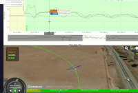
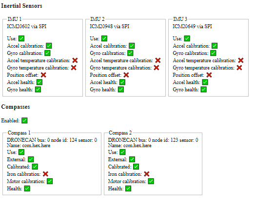
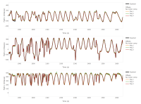
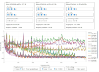
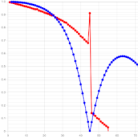
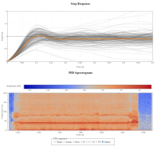

.. _common-webtools:

=======================================================================
`ArduPilot WebTools <https://firmware.ardupilot.org/Tools/WebTools/>`__
=======================================================================

This is a collection of log analysis tools that are web-based.

:ref:`UAV Log Viewer <common-uavlogviewer>`
===========================================
For plotting log file data versus time, 3D earth track of flight,access to parameters,etc.

`Hardware Report <https://firmware.ardupilot.org/Tools/WebTools/HardwareReport/>`__
===================================================================================
Provides a overview of connected hardware from a parameter file or log. If a log is used, more information can be provided, such as sensor health status and exact firmware version. A range of options are available to extract mission, lua scripts used, and parameters from logs: all, only changed, or minimal removing calibration parameters. Includes visualization for sensor position offsets.

`MAGFit <https://firmware.ardupilot.org/Tools/WebTools/MAGFit/>`__
==================================================================
Used to calibrate or fine tune calibration of compass from flight log. This tool fits the logged magnetometer data to the world magnetic model providing offsets, iron correction, scale, motor compensation and checks for proper orientation.

`Filter Review <https://firmware.ardupilot.org/Tools/WebTools/FilterReview/>`__
===============================================================================
Gyro noise and filter configuration tool. Uses raw or batch IMU logs to show the vehicle's noise profile. Filters can be applied to logged pre-filter data to see the effect without the need to fly again. Advanced user tool.

How to use Filter Review
------------------------

#. **Log it.** Set up `batch <https://ardupilot.org/copter/docs/common-imu-batchsampling.html>`__ or `raw <https://ardupilot.org/copter/docs/common-raw-imu-logging.html>`__ IMU logging, then fly a steady hover of at least 30 seconds. Some faster flying afterwards helps check the notch tracking.
#. **Load the log** with the file button. The log type and filter version are filled in from the log.
#. **Pick a hover.** In the Flight Data plot, click and drag to zoom in on the steady hover, leaving out take off, landing and big throttle changes. This sets the Analysis time. Then click Calculate.
#. **Find the noise.** The IMU Spectrum shows how much noise the gyros see at each frequency. Peaks in the Pre-filter lines are noise to be removed. On multicopters these are usually motor noise at the motor rotation frequency and its multiples (harmonics). The Post-filter lines are what the flight controller acts on, and should be low and flat with no remaining peaks.
#. **Check the notch.** Tick "Show notch 1" to draw where the notch filter sits. The notch should cover the noise peaks. The IMU Spectrogram shows whether the notch follows the noise as the throttle changes.
#. **Try changes.** Edit the values in Filter Configuration and click Recalculate filters. The Estimated post-filter lines show what the noise would look like with the new settings, without another flight. Hover over a parameter name for its description.
#. **Don't over filter.** Every filter adds delay (phase lag), which makes control worse. The Frequency Response plot shows the delay added. Use the least filtering that removes the peaks.
#. **Save and confirm.** Save Parameters, load the file into the autopilot, and fly again to confirm the result.

See `Managing Gyro Noise with the Dynamic Harmonic Notch Filters <https://ardupilot.org/copter/docs/common-imu-notch-filtering.html>`__ for more detail on setting up the notch filters.

`Filter Tool <https://firmware.ardupilot.org/Tools/WebTools/FilterTool/>`__
===========================================================================
Bode plot tool to give insight into gyro low pass and notch filter setup. This tool visualizes the attenuation and phase lag of a filter setup loaded from a parameter file. For filter setup the FilterReview tool it is recommended it provides the same bode plot feedback. This filter tool allows the attenuation and phase lag of each filter to be plotted individually, something which the filter review tool cannot do. This tool also provides a estimated response for the rate PID gains. Advance user tool.

`PID Review <https://firmware.ardupilot.org/Tools/WebTools/PIDReview/>`__
=========================================================================
Review PID tune in the frequency domain. Step response estimate is generated. Results are split based on parameter changes. Advance user tool.

.. toctree::
    :hidden:

    UAV LogViewer <common-uavlogviewer>

[copywiki destination="copter,plane,rover,dev,sub,antennatracker,planner"]