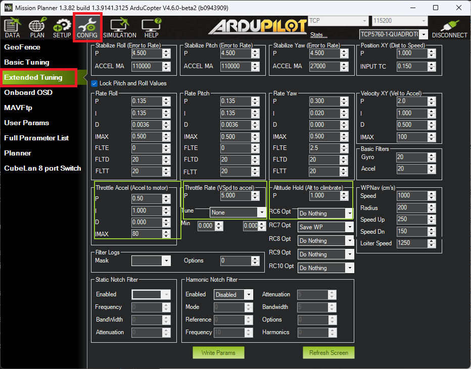
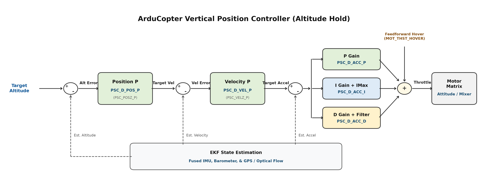
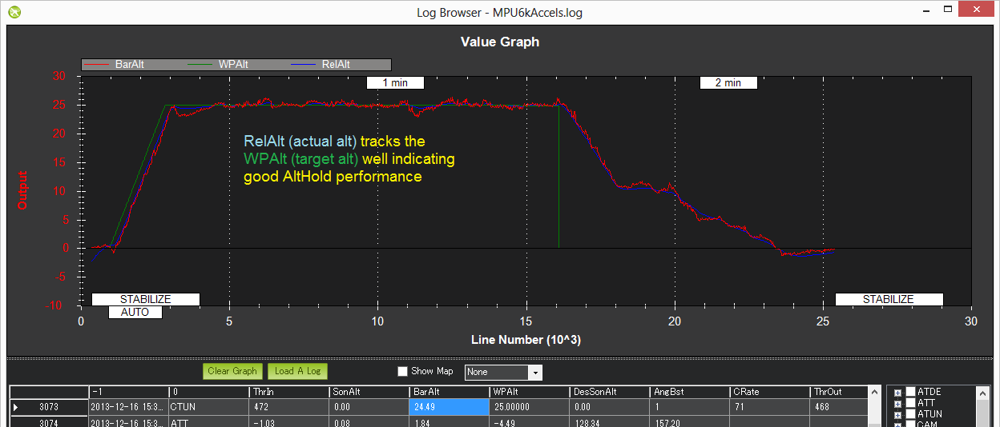

.. _altholdmode:

==================
Altitude Hold Mode
==================

In altitude hold mode, Copter maintains a consistent altitude while
allowing roll, pitch, and yaw to be controlled normally. This page
contains important information about using and tuning alt hold.

Overview
========

When altitude hold mode (aka AltHold) is selected, the throttle is
automatically controlled to maintain the current altitude. Roll, Pitch
and yaw operate the same as in :ref:`Stabilize mode <stabilize-mode>` meaning that
the pilot directly controls the roll and pitch lean angles and the
heading.

Automatic altitude hold is a feature of many other flight modes
(:ref:`Loiter <loiter-mode>`,
:ref:`Sport <sport-mode>`, etc) so the
information here pertains to those modes as well.

.. note::

   The autopilot uses a barometer which measures air pressure
   as the primary means for determining altitude ("Pressure Altitude") and
   if the air pressure is changing in your flight area due to extreme
   weather, the copter will follow the air pressure change rather than
   actual altitude.  When fitted and enabled, a downward facing rangefinder
   such as LiDAR or SONAR will automatically provide even more accurate 
   altitude maintenance, up to the limit of the sensor.

.. _altholdmode_controls:

Controls
========

The pilot can control the climb or descent rate of the vehicle with the
throttle stick.

-  If the throttle stick is in the middle (40% ~ 60%) the vehicle will
   maintain the current altitude.
-  Outside of the mid-throttle deadzone (i.e. below 40% or above 60%)
   the vehicle will descend or climb depending upon the deflection of
   the stick.  When the stick is completely down the copter will descend
   at 2.5m/s and if at the very top it will climb by 2.5m/s.  These
   speeds can be adjusted with the :ref:`PILOT_SPD_UP<PILOT_SPD_UP>` and :ref:`PILOT_SPD_DN<PILOT_SPD_DN>` parameters. The acceleration used to establish these speeds is set by :ref:`PILOT_ACC_Z<PILOT_ACC_Z>`.
-  The size of the deadband can be adjusted with the :ref:`THR_DZ<THR_DZ>` parameter.  This param's value should be between "0" and
   "400" with "0" meaning no deadband.  "100" would produce a deadband
   10% above and below mid throttle (i.e. deadband extends from 40% to
   60% throttle stick position).

Copter allows arming and disarming in altitude hold mode. When
disarming, the copter may need to rest in the landing position for a few
seconds to allow the "landing checker" to verify that the copter has
landed before you are able to disarm.

.. _altholdmode_tuning:

Tuning
======

The Altitude Hold mode utilizes a cascaded controller loop consisting of a position controller, a velocity controller, and an acceleration controller:

* **Position Controller (Altitude Hold P)**: :ref:`PSC_D_POS_P <PSC_D_POS_P>` converts altitude error (difference between target and estimated altitude) into a desired climb or descent rate. A higher value makes the vehicle attempt to maintain altitude more aggressively, but setting it too high can cause jerky throttle response or vertical oscillations.
* **Velocity Controller (Throttle Rate P)**: :ref:`PSC_D_VEL_P <PSC_D_VEL_P>` converts the climb or descent rate error into a desired vertical acceleration. This parameter normally does not require tuning.
* **Acceleration Controller (Throttle Accel PID)**: Converts vertical acceleration error into motor throttle output using :ref:`PSC_D_ACC_P <PSC_D_ACC_P>`, :ref:`PSC_D_ACC_I <PSC_D_ACC_I>`, and :ref:`PSC_D_ACC_D <PSC_D_ACC_D>`. The output is summed with the feedforward hover throttle (:ref:`MOT_THST_HOVER <MOT_THST_HOVER>`) to drive the motor matrix.

Tuning Guidelines:

* The 1:2 ratio of P to I (i.e. ``PSC_D_ACC_I`` is twice ``PSC_D_ACC_P``) should typically be maintained when modifying Throttle Accel gains.
* On very powerful copters (high thrust-to-weight ratio), you may get smoother response and eliminate vertical bouncing by reducing both :ref:`PSC_D_ACC_P <PSC_D_ACC_P>` and :ref:`PSC_D_ACC_I <PSC_D_ACC_I>` by 50% (e.g., P to 0.5, I to 1.0, or scaling proportionally with :ref:`MOT_THST_HOVER <MOT_THST_HOVER>`).
* If the vehicle slowly oscillates up and down in AltHold, reduce both :ref:`PSC_D_POS_P <PSC_D_POS_P>` and :ref:`PSC_D_VEL_P <PSC_D_VEL_P>` by 20% to 50%.

In Mission Planner, these parameters can be configured under **CONFIG -> Extended Tuning** in the **Altitude Hold (Alt to climbrate)**, **Throttle Rate (VSpd to accel)**, and **Throttle Accel (Accel to motor)** sections, or directly via the **Full Parameter List**.

.. note::

   In Copter 4.7 and later, vertical position controller parameters use NED naming conventions (:ref:`PSC_D_POS_P <PSC_D_POS_P>`, :ref:`PSC_D_VEL_P <PSC_D_VEL_P>`, and :ref:`PSC_D_ACC_P <PSC_D_ACC_P>`). In Copter 4.6 and earlier, these were named ``PSC_POSZ_P``, ``PSC_VELZ_P``, and ``PSC_ACCZ_*``.

.. _altholdmode_verifying_althold_performance_with_dataflash_logs:

Verifying AltHold performance with dataflash logs
=================================================

Viewing the altitude hold performance is best done by :ref:`downloading a dataflash log <common-downloading-and-analyzing-data-logs-in-mission-planner>`
from your flight, then open it with the mission planner and graph the
barometer altitude, desired altitude and inertial navigation based
altitude estimate.  This data is found in slight different columns
depending upon the version and board.

CTUN's BAlt (baroalt), DAlt (desired alt) and Alt (inertial nav alt estimate)

The three should track well as shown below.

.. _altholdmode_common_problems:

Common Problems
===============

#. High vibrations can lead to the copter rapidly climbing as soon as
   altitude hold is engaged.  Check the :ref:`Measuring Vibration <common-measuring-vibration>`
   and :ref:`Vibration Dampening <common-vibration-damping>`
   wiki pages for details on how to measure and reduce vibrations.
#. Copter slowly descends or climbs until the pilot retakes control in
   stabilize.  Normally this is caused by not having the throttle stick
   in the mid position.  This commonly happens when the pilot is
   switching into AltHold from a manual flight mode (like Stabilize) on
   a copter that does not hover at mid throttle.  See the :ref:`wiki page related to setting the mid throttle position <ac_throttlemid>`.
#. The motors seem to stop for a moment just as AltHold is engaged but
   then it soon recovers.  This normally occurs when the pilot enters
   AltHold while climbing rapidly.  The target altitude is set at the
   moment the pilot switches into alt hold but because the vehicle is
   rising quickly it flies above the target.  The aggressive altitude
   hold controller then responds by momentarily reducing the motors to
   near minimum until the copter begins falling back to the target
   altitude.  The workaround is to enter AltHold while the copter is
   flying at a stable altitude.
#. Air pressure changes cause the vehicle to drift up or down by a
   couple of meters over longer period of time or for the altitude shown
   on the GCS to be inaccurate by a couple of meters including
   occasional negative altitudes (meaning altitudes below the home
   altitude).
#. Momentary altitude loss of 1m ~ 2m when the copter levels out after a
   high speed forward flight.  This is caused by an aerodynamic effect
   which leads to a momentary low pressure bubble forming on the top of
   the copter where the autopilot is mounted which leads the
   altitude hold controller to believe it is climbing so it responds by
   descending.  There is no cure for this behaviour at the moment
   although increasing the ``EK2_ALT_M_NSE`` parameter reduces 
   the effect but increases the change of Common Problem #1
   listed above. The ``EK2_ALT_M_NSE`` parameter has a range from 0.1 to
   10.0 and allows increments of 0.1.
#. Altitude hold becomes erratic when the vehicle is close to the ground
   or during landing.  This can be caused by the barometer being
   affected by pressure changes created by prop-wash.  The solution is
   to move the autopilot out of the prop wash effect or shield
   it within an appropriately ventilated enclosure.
#. Sudden altitude changes caused by light striking the barometer. 

Adequate Power
==============

It is very important that the vehicle has enough power available. 
Without this the AltHold and attitude controllers can require more power
than is available from one or more motors and will be forced to
sacrifice some control which could lead to a loss of attitude or
altitude.

Ideally the vehicle should be able to hover at about 50% throttle (mid
stick) and anything higher than 70% is dangerous.

.. warning::

   If you incorporate expo on your transmitter, that directly
   increases the size of the Alt Hold throttle dead band.
