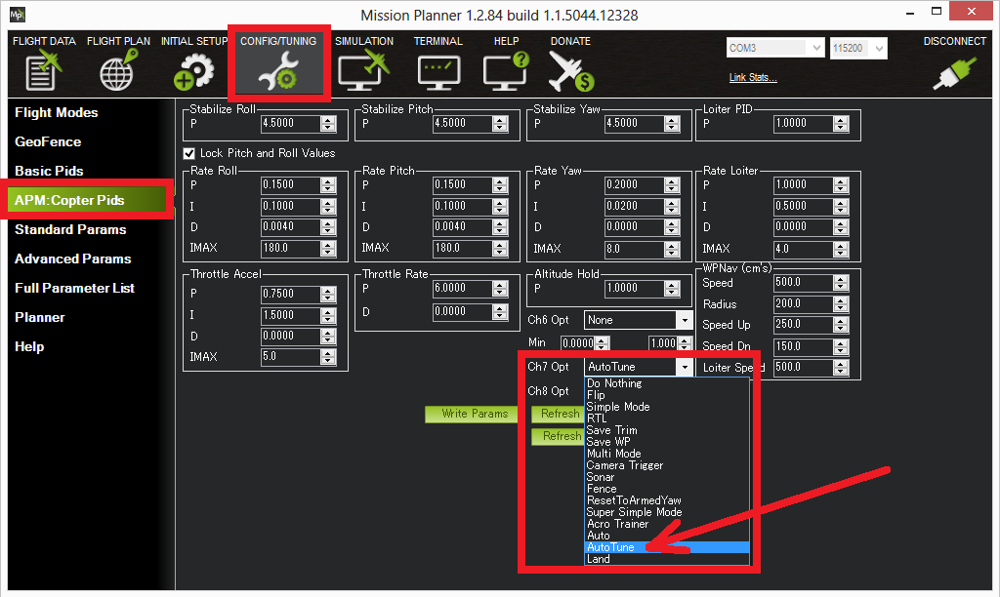

.. _autotune:

========
AutoTune
========

AutoTune attempts to automatically tune the Stabilize P, Rate P and D, and maximum rotational accelerations to provide the highest response without significant overshoot. Copter needs to be "basically" flyable in :ref:`AltHold mode <altholdmode>` before attempting to use AutoTune as the feature needs to be able to "twitch" the copter in the roll, pitch and yaw axes.

.. warning::

   AutoTune is not always able to determine a good tune for the vehicle and may result in gains that lead to an unflyable vehicle that may crash.  Please follow the :ref:`Tuning Process Instructions <tuning-process-instructions>` before attempting to use AutoTune. Only after following those instructions, and :ref:`evaluating your initial tune <evaluating-the-aircraft-tune>`, should you try AutoTune.

.. note:: using :ref:`quiktune` before AUTOTUNE, AND setting up the noise notch filtering, see :ref:`common-imu-notch-filtering`, is highly recommended in order to get the best tune and avoid possible crashes when using AUTOTUNE.

..  youtube:: js2GzeRysAc
    :width: 100%

There are number of problems that can prevent AutoTune from providing a good tune including:

- Strong wind
- High levels of gyro noise
- Non-linear ESC response caused by the incorrect value of :ref:`MOT_THST_EXPO <MOT_THST_EXPO>`
- Flexible frame or payload mount
- Overly flexible vibration isolation mount
- Very low setting for :ref:`MOT_SPIN_MIN <MOT_SPIN_MIN>`
- Overloaded propellers or motors

Setup before flying in AutoTune mode
====================================

1. Set up one flight mode switch position to be AltHold.
2. Set an RC channel :ref:`Auxiliary Function <common-auxiliary-functions>` switch to AutoTune to allow you to turn the auto tuning on/off with a switch.

   .. note:: you can also set the AUTOTUNE flight mode as a mode on your flight mode switch to activate AutoTune

3. Remove the camera gimbal or any other parts of the frame that could wobble in flight
4. Select which combination of axes (roll, pitch, yaw) you wish to tune using the :ref:`AUTOTUNE_AXES <AUTOTUNE_AXES__AC_AutoTune_Multi>` parameter
5. Set the autotune's aggressiveness using the :ref:`AUTOTUNE_AGGR <AUTOTUNE_AGGR>` parameter (0.1=aggressive, 0.075=medium, 0.050=weak), normally start with the default 0.075.
6. For large copters (with props at least 13inch or 33cm diameter) set the Rate Roll and Pitch filters to 10hz, these are: :ref:`ATC_RAT_RLL_FLTT <ATC_RAT_RLL_FLTT__AC_AttitudeControl_Multi>`, :ref:`ATC_RAT_RLL_FLTD<ATC_RAT_RLL_FLTD__AC_AttitudeControl_Multi>`, :ref:`ATC_RAT_PIT_FLTT <ATC_RAT_PIT_FLTT__AC_AttitudeControl_Multi>`, :ref:`ATC_RAT_PIT_FLTD <ATC_RAT_PIT_FLTD__AC_AttitudeControl_Multi>`
7. It is recommended to enable :ref:`battery voltage scaling of PID gains <current-limiting-and-voltage-scaling>`

How to invoke AutoTune
======================

#. Wait for a calm day and go to a large open area.
#. Ensure the Aux AUTOTUNE switch, if used, is in the LOW position.
#. Take off and put the copter into AltHold mode at a comfortable
   altitude.
#. Face the vehicle so that it will twitch at 90degrees from the direction the wind is blowing (i.e. if tuning Roll first, point the vehicle into the wind)

   .. image:: ../images/autotune_copterwind.png
       :target: ../_images/autotune_copterwind.png
       :width: 500px
#. Set the AUX switch to the HIGH position, or switch to AUTOTUNE mode, to engage auto tuning:

   -  You will see it twitch left and right for a few minutes, then it
      will repeat forward and back, and then in yaw (depending on
      :ref:`AUTOTUNE_AXES <AUTOTUNE_AXES__AC_AutoTune_Multi>`). Roll and
      pitch twitches lean the vehicle by up to about half of
      :ref:`ATC_ANGLE_MAX<ATC_ANGLE_MAX>` (15 degrees with the default of 30
      degrees). Yaw twitches can be larger, up to
      :ref:`ATC_ANGLE_MAX<ATC_ANGLE_MAX>`.
   -  Use the roll, pitch, yaw or throttle stick at any time to reposition
      the copter if it drifts away. While the sticks are being used the
      original PID gains are used. When you release the sticks it will
      continue auto tuning where it left off.
   -  Move the AUX switch into the LOW position, or change flight mode if using AUTOTUNE flight mode, at any time to
      abandon the autotuning and return to the original PIDs.
   -  Make sure that you do not have any trim set on your transmitter or
      the autotune may not get the signal that the sticks are centered.

#. When the tune completes the copter will change back to the original
   PID gains.
#. Put the AUX switch into the LOW position and then back to the HIGH
   position to test the tuned PID gains, or if using the AUTOTUNE flight mode, switch out and then back into that mode.
#. Put the AUX switch into the LOW position, or switch out of AUTOTUNE flight mode, to fly using the original PID gains.
#. If you are happy with the autotuned PID gains, leave the AUX
   switch in the HIGH position, or switch back into AUTOTUNE flight mode and land and disarm to save the PIDs permanently.

   If you DO NOT like the new PIDS, switch the AUX switch LOW or out of AUTOTUNE flight mode, to return to the original PIDs. The gains will not be saved when you disarm.

If you find after performing an AutoTune that the vehicle feels overly twitchy when flying Stabilize, AltHold or PosHold (but ok in more
autonomous modes like Loiter, RTL, Auto) try increasing the :ref:`ATC_INPUT_TC<ATC_INPUT_TC>` parameter to 0.25.  This smooths out the pilot's input.
Alternatively try reducing the :ref:`AUTOTUNE_AGGR <AUTOTUNE_AGGR>` parameter (it should always be in the range 0.05 to 0.10) and try again.

If the vehicle feels sloppy after the AutoTune, try increasing the :ref:`AUTOTUNE_AGGR <AUTOTUNE_AGGR>` parameter as high as 0.10 and attempt the autotune again.

Invoke AutoTune with Position Hold
==================================

.. warning::

   A better tune can often be achieved by invoking AutoTune from AltHold as described above instead of from Loiter or PosHold as described below. Using AUTOTUNE flight mode also has this possible disadvantage.
   
AutoTune performs a weak position hold if invoked from Loiter or PosHold flight modes (as opposed to AltHold) while doing an autotune. If using the AUTOTUNE flight mode, this weak position hold is also used.

   .. image:: ../images/autotune_from_loiter.png
       :target: ../_images/autotune_from_loiter.png
       :width: 400px

- The vehicle will gently lean (up to 10 degrees) towards a "target point" which is initially set to the vehicle's location at the moment AutoTune was invoked.
- The pilot can reposition the vehicle using the roll, pitch, yaw or throttle sticks.  The target position will be reset to the vehicle's location at the moment the pilot releases the roll and pitch sticks.
-  The altitude is maintained with the altitude hold controller so the
   vehicle will attempt to hold its current altitude when the throttle stick
   is near mid-throttle. It will climb or descend at up
   to 2.5m/s (this speed is adjustable with the :ref:`PILOT_SPD_UP<PILOT_SPD_UP>` and :ref:`PILOT_SPD_DN<PILOT_SPD_DN>`
   parameters). The acceleration used to establish these speeds is set by :ref:`PILOT_ACC_Z<PILOT_ACC_Z>`.
- To twitch perpendicular to the wind direction, the vehicle may suddenly rotate in either direction up to 90 degrees as it drifts 5m (or more) from the target location.
- If there is little or no wind, the vehicle's gentle position control may mean it moves back and forth, ping-ponging around the target point changing yaw each time it strays more than 5m from the target.  In these cases, it may be more comfortable to revert to the simpler AltHold-based AutoTune. 

Testing Tune in Other Modes
===========================

A successfully completed tune can be tested in any mode, not just the one (e.g. AltHold or Loiter) used for entry. A switch can be set up with ``RCx_OPTION`` = 180 (AUTOTUNE_TEST_GAINS) that will allow switching between the original and autotuned gains in any mode, after AutoTune has completed. If this switch is set up, but not changed after AutoTune has completed, it has no effect. Otherwise, if switched high the tuned gains are in effect, and if low the original gains. These then apply in any flight mode, and the gains selected by the switch position will be made permanent upon the next disarm.

If AutoTune fails
=================

AutoTune will stop and report a failure when it becomes clear that the vehicle cannot be tuned well, rather than producing a poor or dangerous tune. The reason is sent to the ground station:

- ``AutoTune: Failed to level, please tune manually``: between each twitch the vehicle must return close to its target attitude (roll, pitch and heading) and stop rotating, and hold that for 0.25 seconds, before the next twitch can start. The allowed error starts small and is relaxed over 4 seconds, to at most 5 degrees and 10 deg/s (15 deg/s in yaw). This message means the vehicle had still not settled 6 seconds after the previous twitch. If the vehicle is still turning to its target heading (for example after the heading is re-pointed in Loiter or PosHold), the 4 and 6 second times only start once it reaches that heading, although this wait is limited to 20 seconds. This is commonly caused by wind or turbulence, or by poor original gains (between twitches the vehicle levels using its original P and D gains, with the rate I gain reduced to one tenth of P and feed-forward switched on). Using the sticks does not cause this failure, as it pauses the tune.
- ``AutoTune: Twitch Size Determination Failed``: during the rate tests, the vehicle repeatedly reached the maximum test angle (half of :ref:`ATC_ANGLE_MAX<ATC_ANGLE_MAX>` in roll and pitch) before the response to the twitch could be measured, even after the requested rotation rate had been reduced to its lower limit. Check that :ref:`ATC_ANGLE_MAX<ATC_ANGLE_MAX>` is reasonable, and that the vehicle can stop a rotation quickly (it has enough motor headroom and reasonable starting rate gains).
- ``AutoTune: Rate D Gain Determination Failed`` or ``AutoTune: Rate P Gain Determination Failed``: during the Rate P step, the bounce-back after each twitch (how far the rotation rate drops back from its peak during the twitch) stayed above the threshold set by :ref:`AUTOTUNE_AGGR <AUTOTUNE_AGGR>` while the rate D and P gains were reduced, until D reached :ref:`AUTOTUNE_MIN_D <AUTOTUNE_MIN_D>` (Rate D) or P reached its minimum (Rate P). Common causes are high gyro noise, frame or mount flex, a low :ref:`AUTOTUNE_AGGR <AUTOTUNE_AGGR>`, or an :ref:`AUTOTUNE_MIN_D <AUTOTUNE_MIN_D>` that is too high.
- ``AutoTune: Angle P Gain Determination Failed``: during the Angle P Down step, the angle overshoot could not be brought within limits, even with the angle P gain reduced to its minimum.

When AutoTune fails it stops twitching and the vehicle flies on its original gains. Switch out of AutoTune (or set the AutoTune switch low), land, correct the cause, and repeat the AutoTune or do a manual tune. The axis that failed is not saved, but any axes completed earlier in the same flight will still be saved if you land and disarm while still in AutoTune, so switch out of AutoTune before disarming if you do not want them. One exception: if both yaw tuning options are selected in :ref:`AUTOTUNE_AXES <AUTOTUNE_AXES__AC_AutoTune_Multi>` (e.g. 12 or 15), the "Yaw(E)" and "Yaw(D)" passes share the same yaw gains, so if "Yaw(E)" completes and "Yaw(D)" then fails, disarming in AutoTune saves the yaw gains left by the failed "Yaw(D)" pass. In that case switch out of AutoTune before disarming.

Re-engaging AutoTune after a failure discards the axes completed earlier and restarts the tune from the first axis. To keep the completed axes, land and disarm in AutoTune before trying again.

The message ``AutoTune: Min Rate D limit reached`` is not a failure. It is sent when rate D has been reduced to :ref:`AUTOTUNE_MIN_D <AUTOTUNE_MIN_D>` during the Rate D Up or Rate D Down steps. That step finishes with D at the minimum and the tune continues. On the "Yaw(E)" axis the same message instead means the yaw error filter, :ref:`ATC_RAT_YAW_FLTE <ATC_RAT_YAW_FLTE__AC_AttitudeControl_Multi>`, has reached its fixed minimum of 1 Hz, and :ref:`AUTOTUNE_MIN_D <AUTOTUNE_MIN_D>` plays no part. If this is seen on the other axes, it may be worth reducing :ref:`AUTOTUNE_MIN_D <AUTOTUNE_MIN_D>` or increasing :ref:`AUTOTUNE_AGGR <AUTOTUNE_AGGR>`.

Individual twitches may also be abandoned and repeated without any message, for example if the vehicle leans too far or initially rotates the wrong way.

Some signs that AutoTune has been successful are (besides DataFlash logs and Ground Control Station messages):

- An increase in the values of :ref:`ATC_ANG_PIT_P <ATC_ANG_PIT_P>` and :ref:`ATC_ANG_RLL_P <ATC_ANG_RLL_P>`.
- :ref:`ATC_RAT_PIT_D <ATC_RAT_PIT_D__AC_AttitudeControl_Multi>` and :ref:`ATC_RAT_RLL_D <ATC_RAT_RLL_D__AC_AttitudeControl_Multi>` are larger than :ref:`AUTOTUNE_MIN_D <AUTOTUNE_MIN_D>` x (1 - :ref:`AUTOTUNE_GMBK <AUTOTUNE_GMBK>`). The saved D gains are reduced by :ref:`AUTOTUNE_GMBK <AUTOTUNE_GMBK>` (25% by default) after tuning, so they can be below :ref:`AUTOTUNE_MIN_D <AUTOTUNE_MIN_D>` itself. If the ``AutoTune: Min Rate D limit reached`` message was seen while roll or pitch was being tuned, the D gain of that axis will be exactly :ref:`AUTOTUNE_MIN_D <AUTOTUNE_MIN_D>` x (1 - :ref:`AUTOTUNE_GMBK <AUTOTUNE_GMBK>`).

AutoTune finds the highest gains each axis can tolerate and then reduces them by :ref:`AUTOTUNE_GMBK <AUTOTUNE_GMBK>` (25% by default) to leave a stability margin. The angle P gains are also reduced by :ref:`AUTOTUNE_AGGR <AUTOTUNE_AGGR>`. Even so, some aircraft may feel unnecessarily responsive to the pilot's inputs after an AutoTune. In that case, rather than reducing the tuned gains by hand:

- increase :ref:`ATC_INPUT_TC<ATC_INPUT_TC>` to soften the response to the pilot's inputs without reducing the vehicle's ability to reject disturbances, or
- increase :ref:`AUTOTUNE_GMBK <AUTOTUNE_GMBK>` and repeat the AutoTune to obtain a tune with more stability margin.

Small aerobatic aircraft may prefer to keep the tuned values as high as possible.

Additional Notes
================

- AutoTune can be setup as a flight mode.  Switching into or out of the AutoTune flight mode responds in the same way as raising or lowering the aux switch high assigned to the AutoTune function.
- In Copter-4.4 (and higher) AutoTune can tune the yaw D gain.
- :ref:`AUTOTUNE_AXES <AUTOTUNE_AXES__AC_AutoTune_Multi>` allows control of which axes are to be tuned.  This is useful if the vehicle's battery life is not long enough to complete all of the axes in one flight.  "1" = tune roll, "2" = tune pitch, "4" = tune yaw (using the yaw error filter, ATC_RAT_YAW_FLTE), "8" = tune yaw (using yaw D).  Add these numbers together to tune multiple axes in a single session. The default is "7" (roll, pitch and yaw).
- :ref:`AUTOTUNE_AGGR <AUTOTUNE_AGGR>`: Should be in the range of 0.05 to 0.10.  Higher values will produce a more aggressive tune but sometimes results in gains that are too high.  More specifically this parameter controls the threshold for D-term bounce back and P-term overshoot. This affects the tuning noise immunity (a higher value is more tolerant to flex in the frame or other disturbances that could trick the tuning algorithm).  High values also leads to a tune that rejects external disturbances better.  Lower values result in a tune that is more responsive to pilot input.

-   The full list of parameters that may be updated by AutoTune

        - Roll angular P gain :ref:`ATC_ANG_RLL_P <ATC_ANG_RLL_P>` 
        - Roll rate P, I and D gains :ref:`ATC_RAT_RLL_P <ATC_RAT_RLL_P__AC_AttitudeControl_Multi>`, :ref:`ATC_RAT_RLL_I <ATC_RAT_RLL_I__AC_AttitudeControl_Multi>`, :ref:`ATC_RAT_RLL_D <ATC_RAT_RLL_D__AC_AttitudeControl_Multi>`  
        - Roll max acceleration :ref:`ATC_ACC_R_MAX<ATC_ACC_R_MAX>`
        - Pitch angular P gain :ref:`ATC_ANG_PIT_P <ATC_ANG_PIT_P>` 
        - Pitch rate P, I and D gains :ref:`ATC_RAT_PIT_P <ATC_RAT_PIT_P__AC_AttitudeControl_Multi>`, :ref:`ATC_RAT_PIT_I <ATC_RAT_PIT_I__AC_AttitudeControl_Multi>`, :ref:`ATC_RAT_PIT_D <ATC_RAT_PIT_D__AC_AttitudeControl_Multi>`  
        - Pitch max acceleration :ref:`ATC_ACC_P_MAX<ATC_ACC_P_MAX>`
        - Yaw angular P gain :ref:`ATC_ANG_YAW_P <ATC_ANG_YAW_P>`
        - Yaw rate P and I gains :ref:`ATC_RAT_YAW_P <ATC_RAT_YAW_P__AC_AttitudeControl_Multi>`, :ref:`ATC_RAT_YAW_I <ATC_RAT_YAW_I__AC_AttitudeControl_Multi>`
        - Yaw rate D gain :ref:`ATC_RAT_YAW_D <ATC_RAT_YAW_D__AC_AttitudeControl_Multi>` (if yaw D tuning is selected in :ref:`AUTOTUNE_AXES <AUTOTUNE_AXES__AC_AutoTune_Multi>`)
        - Yaw rate error filter :ref:`ATC_RAT_YAW_FLTE <ATC_RAT_YAW_FLTE__AC_AttitudeControl_Multi>` (if yaw tuning is selected)
        - Yaw max acceleration :ref:`ATC_ACC_Y_MAX<ATC_ACC_Y_MAX>`
        - Roll and pitch axis rate feed-forward is enabled (:ref:`ATC_RATE_FF_ENAB <ATC_RATE_FF_ENAB>`)
- The AUTOTUNE algorithm tries to tune until instability is noted and then backs off the final PID values to provide a margin of stability. This back-off percentage can be manipulated with the :ref:`AUTOTUNE_GMBK <AUTOTUNE_GMBK>` parameter and changed from its default value of 25% reduction in gains, in order to get a tune with more, or less, stability margin.
- After you have a good tune, you may wish to increase :ref:`ATC_THR_MIX_MAX <ATC_THR_MIX_MAX>`  to 0.9 (default is 0.5) to increase prioritization of attitude control over throttle.  This can reduce the pitch overshoot sometimes seen (especially on copters with large propellers) in AltHold if the vehicle suddenly slows after performing a fast forward flight.  In this situation, wind catches under the propellers providing lift but also disturbs the vehicle's attitude leading to a conflict between throttle and attitude control.  The danger in increasing this parameter's value is that if the rate gains are later raised so high that the vehicle oscillates badly it may be difficult for the vehicle to descend (because it will prioritize trying to correct the attitude oscillations and never reduce throttle sufficiently).
- AutoTune can **request very large and fast changes in output**\ s to the motors which can cause ESC sync issues especially when using SimonK firmware and/or low KV motors (under 500KV). See this `video showing a test <https://www.youtube.com/watch?v=hBUBbeyLe0Q>`__ which recreates a sync problem.
- For best results, the copter shouldn't be allowed to build up too much horizontal speed. This can be prevented by applying a quick correction between tests (twitches) to stop the vehicle from flying too fast.
- Be advised that AutoTune will engage from Stabilize, so don't accidentally flip your AutoTune switch until you are in AltHold and ready to begin the procedure.
- AutoTune sets the rate I gain equal to the rate P gain for roll and pitch, and the yaw rate I gain to one tenth of the yaw rate P gain.

Common Problems
===============

- If the vehicle will not start tuning (i.e. it won't twitch) even though it is in AutoTune mode then the problem is likely that the roll, pitch, yaw or throttle sticks are not exactly in the middle. It may help to increase the deadzone on the RC input by increasing :ref:`RC1_DZ <RC1_DZ>`, :ref:`RC2_DZ <RC2_DZ>`, :ref:`RC3_DZ <RC3_DZ>` and :ref:`RC4_DZ <RC4_DZ>` to 50 (or higher).
- If the AutoTune produces an overly twitchy vehicle try reducing the :ref:`AUTOTUNE_AGGR <AUTOTUNE_AGGR>` parameter (should never be below 0.05) and perform the AutoTune again.
- If the AutoTune produces a sloppy vehicle, try increasing the :ref:`AUTOTUNE_AGGR <AUTOTUNE_AGGR>` parameter (should never be above 0.1) and perform the AutoTune again.

.. tip::

   When reporting issues with AutoTune please include a description of your frame and a ``.bin`` dataflash log of the flight.

Dataflash logging
=================

ATUN (auto tune overview) and ATDE (auto tune details) messages are
written to the dataflash logs. Some details of the contents of those
messages can be found on the :ref:`Downloading and Analyzing Data Logs in Mission Planner <common-downloading-and-analyzing-data-logs-in-mission-planner_message_details_copter_specific>` wiki page.

Ground Control Station Messages
===============================

Each axis is tuned in several steps. For roll and pitch these are Rate D Up, Rate D Down, Rate P Up, Angle P Down and Angle P Up. Progress messages are sent to the GCS (and recorded in the Dataflash logs) every few seconds, showing the axis, the step, and the progress through that step, for example:

::

 AutoTune: Started
 AutoTune: Roll Rate D Up 25%
 AutoTune: Roll Rate D Up 75%
 AutoTune: Roll Rate P Up 50%

Each step normally needs four successful twitches to complete, so the percentage moves in steps of 25%. An unsuccessful twitch reduces the count, so it may go down as well as up. A step can also end early if a gain reaches its limit.

.. note:: For the "Yaw(E)" axis, the "Rate D" steps tune the yaw rate error filter, :ref:`ATC_RAT_YAW_FLTE <ATC_RAT_YAW_FLTE__AC_AttitudeControl_Multi>`, rather than :ref:`ATC_RAT_YAW_D <ATC_RAT_YAW_D__AC_AttitudeControl_Multi>`. The "Yaw(D)" axis tunes :ref:`ATC_RAT_YAW_D <ATC_RAT_YAW_D__AC_AttitudeControl_Multi>`.

When each axis completes, its new gains are reported:

::

 AutoTune: Roll complete
 AutoTune: Roll Rate: P:0.135, I:0.135, D:0.0036
 AutoTune: Roll Angle P:9.250, Max Accel:1245

and when all axes are complete, ``AutoTune: Success`` is sent.

Anytime the process is interrupted by pilot stick movements, the

::

 AutoTune: pilot overrides active

message appears.

If you stopped the tune and disarmed while still in AUTOTUNE, and an axis tune has been completed, you will get a message showing that the new gains have been saved for the completed axes. If there is not a message to this effect, but you think you finished at least one axis, then you probably disarmed while not in AUTOTUNE mode, and did not actually save them.

::

 AutoTune: Saved gains for Roll Pitch

.. tip:: If you do happen to accidentally discard a session's AUTOTUNE values by disarming when not in AUTOTUNE, you can examine the dataflash log for the GCS messages it sent during the tune and manually set them on the bench.

