.. _mission-command-list:

===========================
Copter Mission Command List
===========================

This page provides details of all the mission commands 
(i.e. `MAVLink commands <https://mavlink.io/en/messages/common.html#mav_commands>`__) supported by Copter that can be run as part of a mission (see :ref:`AUTO flight mode <auto-mode>`).

Each of the commands below is either a "Navigation" command or a "Do" command.  Navigation commands (e.g. "Takeoff" and "Waypoint") affect the
location of the vehicle while "Do" commands (e.g. "Do-Set-Servo" and "Do-Cam-Trigg-Dist") are for auxiliary functions and do not affect the
vehicle's position.

During a mission at most one "Navigation" command and one "Do" command can be running at one time.  The "Do" commands are
run in order, starting as soon as the navigation command before them completes, and continue while the following navigation command executes.
Any "Do" commands that have not completed by the time that following navigation command completes are skipped.  For more information on setting up missions please refer to the
:ref:`Planning a Mission with Waypoints and Events <common-planning-a-mission-with-waypoints-and-events>` page.

Takeoff
~~~~~~~

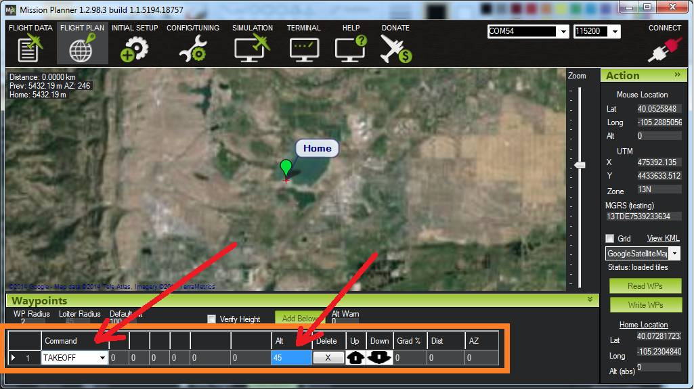

The vehicle will climb straight up from its current location to the
altitude specified (in meters, normally relative to home). The latitude and
longitude fields are ignored and the vehicle holds its heading during the
climb. If the vehicle is on the ground it will climb at least 1m.

A Takeoff must be the first navigation command of any mission that is
started from the ground: AUTO mode cannot be entered while armed and landed
unless it is (a preceding Delay or Do-Aux-Function command is allowed). The
pilot must raise the throttle to start the takeoff unless bit 1 of
:ref:`AUTO_OPTIONS<AUTO_OPTIONS>` ("Allow Takeoff Without Raising Throttle") is set.

If the mission is begun while the copter is already flying, the vehicle
will climb straight up to the specified altitude. If the vehicle is already
above the specified altitude it will not descend; the takeoff command
completes almost immediately and the mission moves on to the next command.

Waypoint
~~~~~~~~

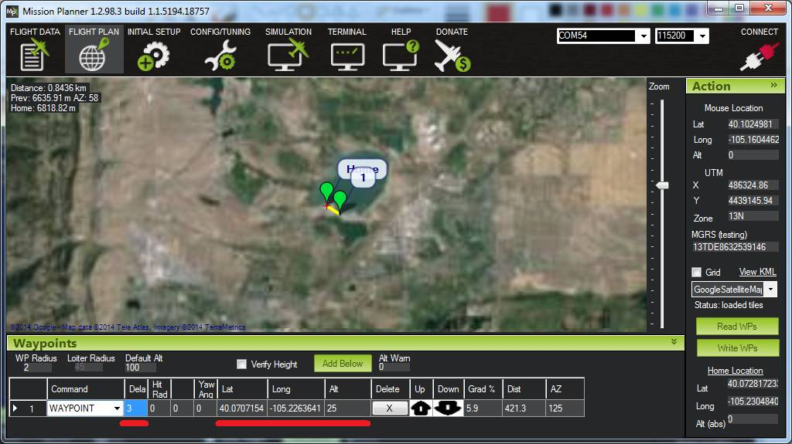

The vehicle will fly a straight line to the location specified as a lat,
lon and altitude (in meters).

**Delay** - the amount of time to wait (in whole seconds) at the waypoint
before proceeding to the next command. A non-zero delay causes the vehicle
to stop at the waypoint.

**Hit Rad** - not supported. Instead, the :ref:`WP_RADIUS_M<WP_RADIUS_M>` parameter is used.
If the vehicle stops at the waypoint (because it has a Delay, or because the
next command requires the vehicle to stop) the waypoint is complete once the
vehicle is within :ref:`WP_RADIUS_M<WP_RADIUS_M>` of it. If the vehicle does not stop, it
rounds the corner towards the next waypoint, passing no further than
:ref:`WP_RADIUS_M<WP_RADIUS_M>` from the waypoint (the corner is also limited by
:ref:`WP_ACC_CNR<WP_ACC_CNR>`), and the waypoint is considered complete half-way through
the turn.

**Yaw Ang** - not supported. The vehicle's heading is controlled by the
:ref:`WP_YAW_BEHAVIOR<WP_YAW_BEHAVIOR>` parameter; to set a specific heading use a
:ref:`CONDITION_YAW <mission-command-list_condition-yaw>` command.

**Lat, Lon** - the latitude and longitude targets.  If both are left as zero, the vehicle's current location (or the previous waypoint, if the vehicle has stopped there) is used, so the vehicle only changes altitude (and waits for any Delay) without moving horizontally.

**Alt** - the target altitude above home in meters.  If left as zero it
will hold the current altitude.

Spline Waypoint
~~~~~~~~~~~~~~~

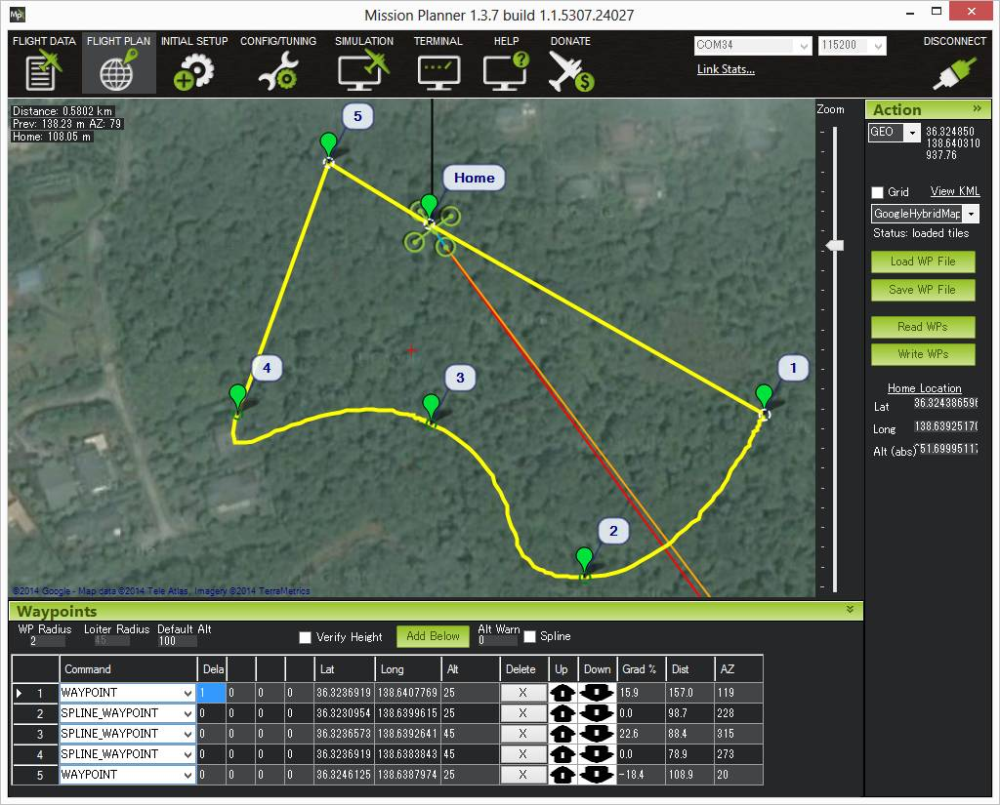

`Spline <https://en.wikipedia.org/wiki/Spline_%28mathematics%29>`__ waypoints take all the same arguments as regular waypoints (lat, lon, alt, delay) but when executed the vehicle will fly smooth paths (both vertically and horizontally) instead of straight lines.  Spline waypoints can be mixed with regular straight line waypoints as shown in the image above.

The Mission Planner shows the path the vehicle will take.  The image
above shows some characteristics of the spline:

-  The 1 second delay at the end of Waypoint #1 causes the vehicle to
   stop so Spline command #2 begins by taking a sharp 90 degree turn
-  The direction of travel as the vehicle passes through Spline Waypoint
   #3 is parallel to an imaginary line drawn between waypoints #2 and #4
-  Waypoint #5 is a straight line so the vehicle lines itself up to
   point towards waypoint #5 even before reaching waypoint #4.

A non-zero delay causes the vehicle to stop at the spline waypoint, and the
following waypoint is then not used to shape the curve.

Arc Waypoint
~~~~~~~~~~~~

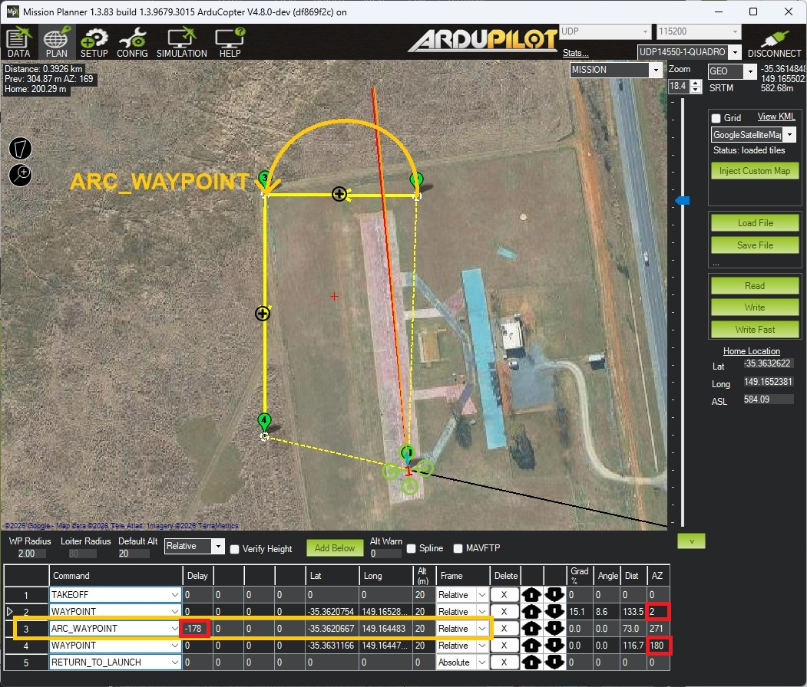

The vehicle will fly an arc using the specified angle to the location specified as a lat, lon and altitude (in meters).

**Arc Angle** - the angle (in degrees) swept by the arc, which is also the change in the vehicle's direction of travel between entering and leaving the arc.
Positive values are clockwise arcs and negative values are counter-clockwise arcs.  Values smaller than 1 degree result in a straight line.
For the arc to begin tangent to the preceding straight leg, set the Arc Angle to twice the difference between the arc waypoint's "AZ" and the preceding waypoint's "AZ" in Mission Planner, after first wrapping that difference into the range -180 to 180 degrees. For example, if the preceding waypoint's AZ is 350 and the arc waypoint's AZ is 10, the difference is +20 degrees (not -340), so the Arc Angle is 40.

There is no Delay field, so the vehicle does not stop at an Arc Waypoint unless the following command requires it to stop (e.g. Return-To-Launch, Takeoff, Loiter_Turns, or the end of the mission).

**Lat, Lon** - the latitude and longitude targets.  If both are left as zero, the previous waypoint's location is used (or the vehicle's current location if the arc is the first leg flown).

.. note:: The arc is only flown when the preceding navigation command is a Waypoint with no delay or another Arc Waypoint, with both or neither using terrain altitude. After any other command (e.g. Takeoff, Loiter_Time or a Spline Waypoint) the vehicle flies a straight line to the arc's end point.

**Alt** - the target altitude above home in meters.  If left as zero it will hold the current altitude.

Loiter_Time
~~~~~~~~~~~

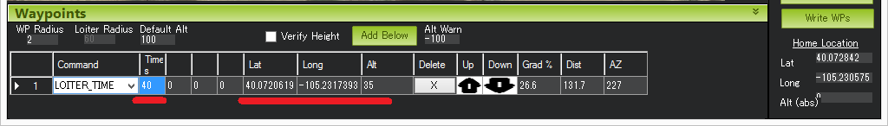

The vehicle will fly to and then wait at the specified location for the
specified number of seconds.  This is the same as a Waypoint command.

**Time** - the number of seconds to remain at the location.

**Lat, Lon** - the latitude and longitude targets. If left as zero it
will hold at the current location.

**Alt** - the target altitude above home in meters. If left as zero it
will hold at the current altitude.

Loiter_Turns
~~~~~~~~~~~~

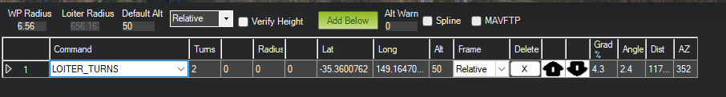

The mission equivalent of the :ref:`Circle flight mode <circle-mode>`.  The vehicle first flies to the nearest point on the circle's edge (climbing or descending to the target altitude on the way), then orbits the specified location for exactly the specified number of turns, and proceeds to the next command once the orbit is complete. For whole turns this is the same point on the circle at which the orbit began. If zero is specified for a latitude/longitude/altitude parameter then the current location value for the parameter will be used.

The radius of the circle is set by the command's Radius field. Negative radius values result in counter-clockwise orbits instead of clockwise. Radius values over 255 meters are rounded down to the nearest 10 meters, and the maximum radius is 2000 meters. The orbit is flown at the waypoint speed (:ref:`WP_SPD<WP_SPD>`), limited by the cornering acceleration, with the vehicle facing the center of the circle (or the direction of travel if bit 1 of :ref:`CIRCLE_OPTIONS<CIRCLE_OPTIONS>` is set). In firmware 4.7 and earlier the orbit is flown at the :ref:`CIRCLE_RATE<CIRCLE_RATE>` rate instead, and the vehicle moves on to the next command as soon as the specified number of turns has been completed, without slowing to a stop at the point where the orbit began.

A radius of 0 causes the vehicle to fly to the location and rotate in place (a panorama) through the specified number of turns at :ref:`CIRCLE_RATE<CIRCLE_RATE>`. The sign of :ref:`CIRCLE_RATE<CIRCLE_RATE>` sets the direction of rotation.

**Turn** - the number of full rotations to complete around the point.
Fractional turns between 0 and 1 are supported. Values above 1 are truncated to a whole number, up to a maximum of 255.

**Radius** - Loiter radius around waypoint. Units are in meters.

**Lat, Lon** - the latitude and longitude targets.  If left as zero it
will circle around the current location.

**Alt** - the target altitude above home in meters.  If left as zero it
will circle at the current altitude.

Loiter_Unlimited
~~~~~~~~~~~~~~~~

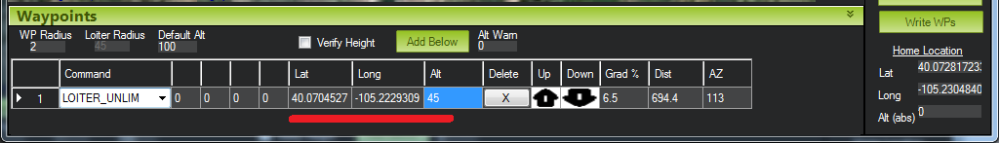

The vehicle will fly to and then wait at the specified location
indefinitely.  The mission will not proceed past this command.

**Lat, Lon** - the latitude and longitude targets. If left as zero it
will wait at the current location.

**Alt** - the target altitude above home in meters. If left as zero it
will wait at the current altitude.

Return-To-Launch
~~~~~~~~~~~~~~~~

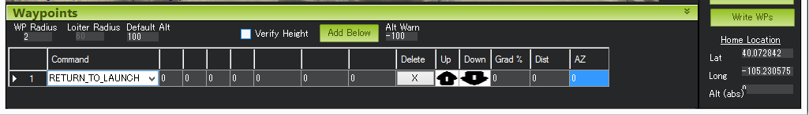

Mission equivalent of the :ref:`RTL flight mode <rtl-mode>`.  As
described on the RTL flight mode wiki page, the vehicle will first climb
to at least the :ref:`RTL_ALT_M<RTL_ALT_M>` parameter's specified altitude (default is 15m;
it will not descend if already higher) before returning to home, or to the
nearest Rally Point if any are defined. Near home the return altitude may be
lower than :ref:`RTL_ALT_M<RTL_ALT_M>` because of :ref:`RTL_CONE_SLOPE<RTL_CONE_SLOPE>`, and it is
also limited by an altitude fence. Whether a Rally Point or home is used also
depends on :ref:`RALLY_LIMIT_KM<RALLY_LIMIT_KM>` and :ref:`RALLY_INCL_HOME<RALLY_INCL_HOME>`. Home is normally where the vehicle
was last armed, but may be moved by a Do-Set-Home command or the ground station.

This command takes no parameters and generally should be the last
command in the mission. Once the vehicle has landed the mission completes
and the vehicle disarms. If :ref:`RTL_ALT_FINAL_M<RTL_ALT_FINAL_M>` is non-zero the vehicle
instead stops at that altitude and holds position.

Land
~~~~

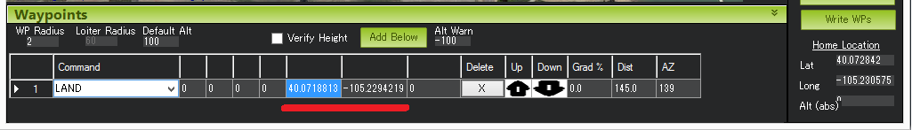

The vehicle will land at its current location or at the lat/lon coordinates
provided. If a location is provided the vehicle first flies there at its
current altitude (the Alt field is ignored) and then descends. This is the
mission equivalent of the :ref:`LAND flight mode <land-mode>`.

Once landed the vehicle disarms and the mission ends, unless bit 2
("ContinueAfterLand") of :ref:`MIS_OPTIONS<MIS_OPTIONS>` is set and the next navigation
command is a Takeoff.

**Lat, Lon** - the latitude and longitude targets. If both are left as zero it
will land at the current location.

Delay
~~~~~

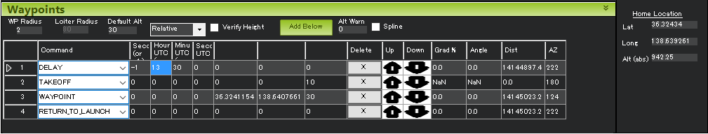

The vehicle will remain at its current location until the specified number of seconds has passed or the absolute time is reached.
The first column ("Seconds") holds the number of seconds to delay.  Set to -1 (or 0) to use the absolute time fields instead.
The "hour UTC", "minute UTC" and "second UTC" fields can be used to specify an absolute time (`UTC <https://en.wikipedia.org/wiki/Coordinated_Universal_Time>`__).  The example above will cause the vehicle to take-off at 1:30pm UTC.  Note that the hour and/or minute field can also be ignored by setting them to -1. An absolute time requires the autopilot to know the UTC time (normally from the GPS); if it does not, the delay completes immediately.

This is a video made during the development of this feature.  Note that the video uses the CONDITION_DELAY command; the DELAY command described here should be used instead.

..  youtube:: 9VK3yjIyCSo
    :width: 100%

Payload Place
~~~~~~~~~~~~~

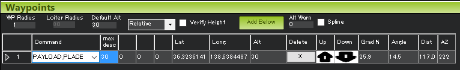

The vehicle flies to the specified location and then descends until it senses that the payload has reached the ground, either from a reduction in the vertical thrust needed to descend, or from the landing detector. The gripper is then released and the vehicle climbs back to the altitude at which the descent started (normally the waypoint altitude) and continues the mission. If lat, lon and alt are all zero, the descent starts from the vehicle's current location.

The first column ("Max Desc") holds the maximum distance, in meters, that the vehicle should descend. If the payload has still not reached the ground after this descent, the payload will not be released and the vehicle will climb back to the waypoint altitude and advance to the next mission command. A value of zero means there is no limit.

Parameters controlling this operation (besides :ref:`Gripper parameters <common-gripper-landingpage>`) are:

- :ref:`PLDP_SPEED_DN<PLDP_SPEED_DN>`: the descent speed in m/s. If zero, :ref:`LAND_SPD_MS<LAND_SPD_MS>` is used. The descent speed is also limited to :ref:`WP_SPD_DN<WP_SPD_DN>`.
- :ref:`PLDP_THRESH<PLDP_THRESH>`: touch-down is detected when the vertical thrust falls below this fraction (0.5 to 0.9, default 0.9) of the reference descent thrust for 0.5 seconds. The reference thrust is the lowest thrust measured over the first 2 seconds after the descent speed has been reached. For example, the default of 0.9 detects touch-down when the thrust drops by 10%. Lower values need a larger thrust reduction before the payload is released.
- :ref:`PLDP_RNG_MAX<PLDP_RNG_MAX>`: if non-zero, release on thrust reduction is only allowed when a downward facing rangefinder reads a height below this value (in meters). If the rangefinder reading is not valid, this height check is skipped. If this is set but no rangefinder is enabled, the Payload Place is abandoned when touch-down is detected, and the vehicle climbs back and continues the mission without releasing the payload.
- :ref:`PLDP_DELAY<PLDP_DELAY>`: the time in seconds the vehicle holds its position after releasing the payload before climbing. This allows the payload to be replaced if the gripper is set to re-engage after a delay (see :ref:`GRIP_AUTOCLOSE<GRIP_AUTOCLOSE>`).

The payload can also be released manually during the descent, for example by setting an RC switch with ``RCx_OPTION`` = 19 (Gripper) to low, or by a ground station :ref:`MAV_CMD_DO_GRIPPER <mav_cmd_do_gripper>` release command. Any gripper release has the same effect, including a mission ``DO_GRIPPER`` command.

- If the gripper is released while the vehicle is descending, this is treated as if the payload had touched down ("PayloadPlace: Manual release" is sent to the ground station). The vehicle stops descending, holds its position for about :ref:`PLDP_DELAY<PLDP_DELAY>` plus 0.5 seconds, climbs back to the altitude at which the descent started and continues the mission. Currently, if the gripper is released before the vehicle has reached its descent speed, the :ref:`PLDP_DELAY<PLDP_DELAY>` hold may be skipped and the vehicle may climb immediately.
- If the gripper is already released when the Payload Place command starts, or is released while the vehicle is still flying to the location, the Payload Place is abandoned ("PayloadPlace: Abort: Gripper Open"). The vehicle does not complete the flight to the location or descend, and the mission continues immediately with the next command.
- Releasing the gripper after the payload has been released has no effect.

.. warning:: In firmware 4.7 and earlier, manual release and the "Abort: Gripper Open" check only work correctly with servo grippers (:ref:`GRIP_TYPE<GRIP_TYPE>` = 1). With an EPM gripper (:ref:`GRIP_TYPE<GRIP_TYPE>` = 2) a held payload is reported as released, so the Payload Place is abandoned before the descent.

.. note:: Make sure the gripper is closed (grabbed) before each Payload Place command, for example by using :ref:`GRIP_AUTOCLOSE<GRIP_AUTOCLOSE>` or a ``DO_GRIPPER`` grab command. Otherwise the second and later Payload Place commands in a mission will be abandoned.

..  youtube:: m4GK4ALqluc
    :width: 100%

Attitude Time
~~~~~~~~~~~~~

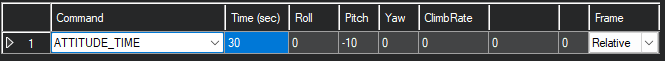

Vehicle maintains the specified roll, pitch, yaw angle and climb rate for the specified time.  GPS is not required while this command is being executed. When the command completes the EKF failsafe is checked again, and if a position estimate is still not available the EKF failsafe action will be taken.

- **Time (sec)**: how long, in whole seconds, the attitude is held. 0 means the command completes immediately.
- **Roll**: positive is lean right, negative is lean left
- **Pitch**: positive is lean back, negative is lean forward
- **Yaw**: 0 is North, 90 is East, 180 is South, 270 is West
- **ClimbRate**: climb rate in whole m/s (positive is up, negative is down), limited to :ref:`WP_SPD_UP<WP_SPD_UP>` and :ref:`WP_SPD_DN<WP_SPD_DN>`. Some ground stations scale this field as if it were a latitude, which can produce a large unintended climb or descent, so it is safest to leave it at 0.

Angles are in whole degrees. The combined roll and pitch lean is limited to the lower of :ref:`ATC_ANGLE_MAX<ATC_ANGLE_MAX>` and the AltHold lean angle limit (but never less than 10 degrees). Horizontal position is not held, so the vehicle will move in the direction of the lean.

..  youtube:: cli1zmPoz3U
    :width: 100%

Script Time
~~~~~~~~~~~

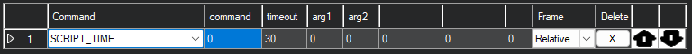

Hands control of the vehicle to a running :ref:`Lua script <common-lua-scripts>` until the script reports that it has finished or the timeout expires, after which the mission moves on to the next command. The script must already be running, and must call ``vehicle:nav_script_time()`` to read the command and its arguments, and ``vehicle:nav_script_time_done(id)`` when it has finished. "timeout" is in seconds (maximum 255). 0 means no timeout, so the mission waits until the script reports that it has finished.

"command" (0 to 255), "arg1", "arg2" (reduced precision numbers), and "arg3" and "arg4" (integers, entered in the Lat and Lon columns) are passed to the script and interpreted by it.
The demonstration below used this SCRIPT_TIME command to execute the "fast descent" script from within Auto mode.

..  youtube:: YD50BxeQm84
    :width: 100%

.. _mission-command-list_do-set-roi:

Do-Set-ROI
~~~~~~~~~~

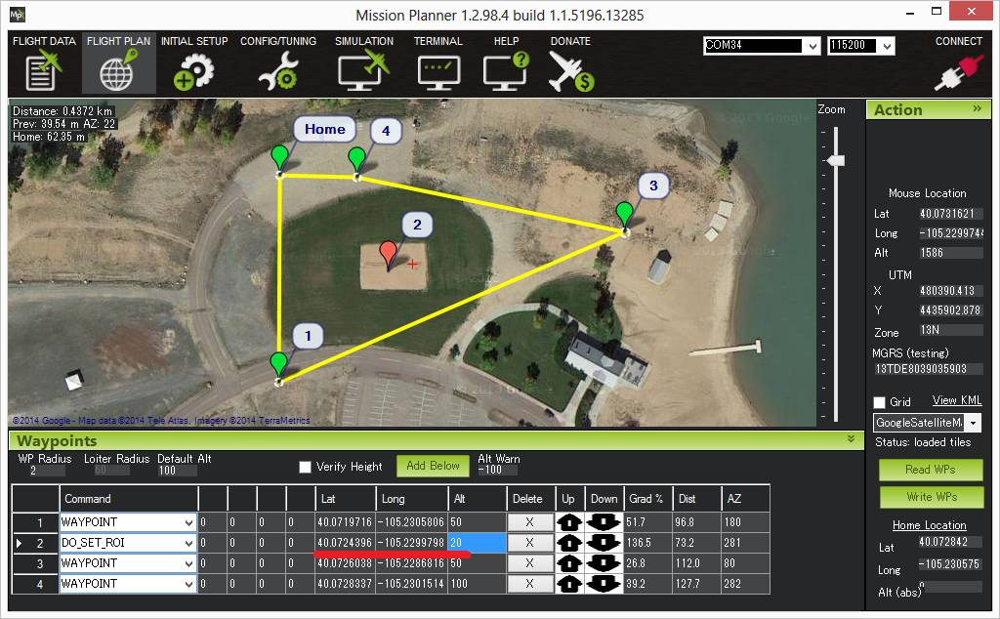

Points the :ref:`camera gimbal <common-cameras-and-gimbals>` at the "region of interest". If no gimbal is fitted, or the gimbal cannot rotate in yaw, the nose of the vehicle is pointed at the region of interest instead. In the example above the camera (or the nose) would be pointed at the red marker.

The camera or nose will continue to point at the red marker until the region of interest is cleared, or Auto mode is exited. A later Condition-Yaw, Takeoff, Land, Payload Place or Return-To-Launch command, or the end of the mission, will also stop the nose from pointing at it (the camera gimbal continues to point at it). To clear the region of interest, and return the vehicle to its default yaw behavior (set by :ref:`WP_YAW_BEHAVIOR<WP_YAW_BEHAVIOR>`) and the gimbal to its default mode, add a second DO_SET_ROI command later in the mission with all zero for Lat, Lon, and Alt.

**Lat, Lon** - the latitude and longitude targets.

**Alt** - the target altitude in meters, in the frame selected in the "Frame" column (normally relative to home).

..  youtube:: W8NCFHrEjfU
    :width: 100%
    
Condition-Delay
~~~~~~~~~~~~~~~

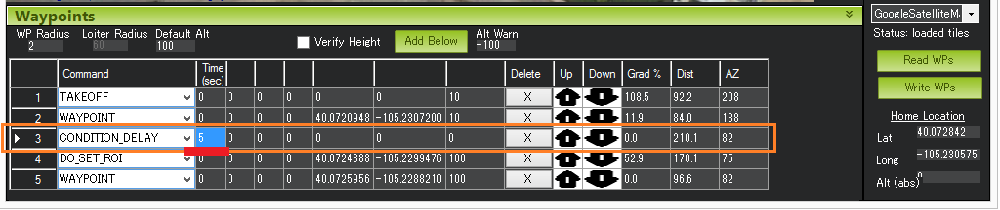

Delays the start of the next "Do" command for the specified number of
seconds. In the example above, Command #4 (Do-Set-Roi) is delayed so
that it only starts 5 seconds after the vehicle has passed Waypoint #2.
Note: this command does not stop the vehicle. Also note that the delay
timer is only active until the next waypoint is reached, so if the "Do"
command hasn't been triggered by then it never will be.

**Time (sec)** - the time to delay the next "Do" command in seconds.

Condition-Distance
~~~~~~~~~~~~~~~~~~

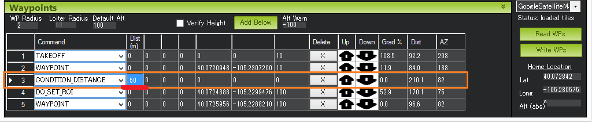

Delays the start of the next "Do" command until the vehicle is within
the specified number of meters of the next waypoint. In the example
above, Command #4 (Do-Set-Roi) is delayed so that it only starts once
the vehicle is within 50m of waypoint #5. Note: this command does not
cause the vehicle to stop or pause during the mission, it only affects
"Do" commands.

**Dist (m)** - how close, in horizontal distance (whole meters), the vehicle
should be to the next waypoint before beginning the next "Do" command.

.. _mission-command-list_condition-yaw:

Condition-Yaw
~~~~~~~~~~~~~

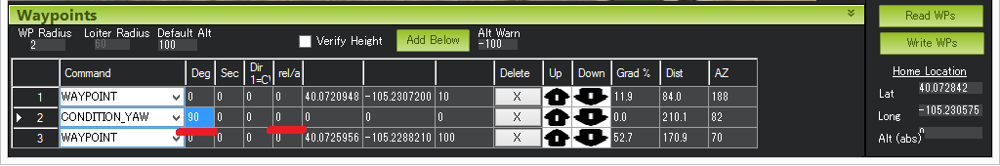

Rotate the nose of the vehicle to an absolute heading, or by a specified
amount relative to the current heading.

This is a conditional command, so any following "Do" commands are not started until the vehicle is within 2 degrees of the target heading. The new heading is only held until the next waypoint begins, after which the vehicle returns to the yaw behavior set by :ref:`WP_YAW_BEHAVIOR<WP_YAW_BEHAVIOR>`. To keep the heading for the following waypoints, set :ref:`WP_YAW_BEHAVIOR<WP_YAW_BEHAVIOR>` = 0.

**Deg** - the desired heading in degrees (0 = North, 90 = East, etc)
when "rel/abs" field is "0" (meaning absolute)

OR the change in heading (in degrees) when "rel/abs" field is "1"
(meaning relative)

**Speed deg/s** - the rotation speed (in deg/sec)
as the vehicle turns to the desired heading. 0 uses the default rate,
:ref:`ATC_RATE_WPY_MAX<ATC_RATE_WPY_MAX>`, which is also the maximum allowed. If
:ref:`ATC_RATE_Y_MAX<ATC_RATE_Y_MAX>` is non-zero and lower, it limits both the default and
the maximum rate.

**Dir 1=CW** - the direction of rotation: 1 = clockwise, -1 = counter-clockwise. When "rel/abs" = "0", a value of 0 turns the shortest way to the target heading. When "rel/abs" = "1", 0 is treated as clockwise.

**rel/abs (0=Abs, 1=Rel)** - allows specifying the heading (i.e. "Deg" field) as an
absolute heading (if "0") or relative to the current heading (if "1")

Do-Jump
~~~~~~~

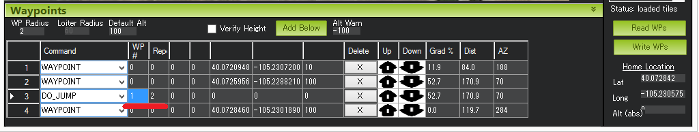

Jump to the specified mission command the specified number of times
before continuing with the mission.  In the example above the vehicle
would fly back-and-forth between waypoints #1 and #2 a total of 3 times
before flying on to waypoint #4.

**WP #** - the mission command to jump to. This must be a valid command
number (1 or higher, within the mission). An invalid target ends the mission.

**Repeat** - the number of times the jump is performed, so the commands
between "WP #" and the Do-Jump are flown Repeat + 1 times in total. 0 means
the jump is never performed. -1 means always jump (repeat forever).

Despite the name, Do-Jump is really a "Nav" command rather than a "Do"
command, so conditional commands like CONDITION_DELAY won't affect
Do-Jump, it will always perform the jump as soon as it hits that
command.

.. warning::

   No more than one hundred (100) Do-Jump commands can be used in a mission. This is reduced to fifteen (15) on boards with less than 500KB of RAM. Additional Do-Jumps with a finite repeat count will be ignored.

Do-Aux-Function
~~~~~~~~~~~~~~~

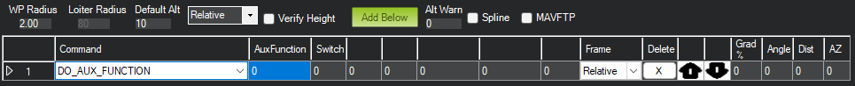

Allows any :ref:`auxiliary function <common-auxiliary-functions>` to be executed from within a mission without setting up an auxiliary switch.  The "AuxFunction" field should be set to the "RCx_OPTION value" from the linked page.  The "Switch" field corresponds to the auxiliary function switch position with "0" meaning "low", "1" meaning "middle" and "2" meaning "high".

Do-Change-Speed
~~~~~~~~~~~~~~~

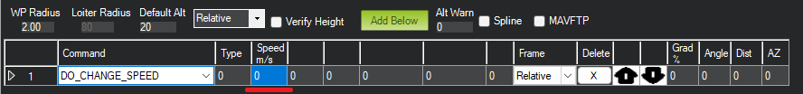

Change the desired maximum speed (in meters/sec) of the vehicle.  Normally the "Type" field is left at 0 meaning the horizontal speed is set.

**Type** - 0 or 1: horizontal speed, 2: climb speed, 3: descent speed

**Speed m/s** - the desired maximum speed in meters/second.

The new speed takes effect immediately and remains in effect for the rest of the mission (until another Do-Change-Speed command, or until Auto mode is re-entered). A speed of 0 or less is ignored, so to return to the default speed, add another Do-Change-Speed command with the speed set to :ref:`WP_SPD<WP_SPD>` (or :ref:`WP_SPD_UP<WP_SPD_UP>` / :ref:`WP_SPD_DN<WP_SPD_DN>` for climb and descent).

Do-Set-Home
~~~~~~~~~~~

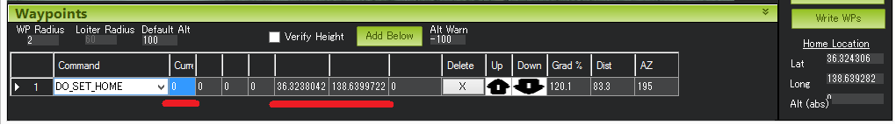

This command should be avoided if possible and instead use :ref:`Rally Points <common-rally-points>` which can also control the position used for Return-To-Launch.

**Current(1)/Spec(0)** - if "1" use the current location as the new home, if "0" use the specified location.

**Lat, Lon, Alt** - the new home location (only used if the first field is "0"). If these are all zero, the current location is used.

The command is ignored if the vehicle does not yet have a position estimate (EKF origin).

Do-Set-Cam-Trigg-Dist
~~~~~~~~~~~~~~~~~~~~~

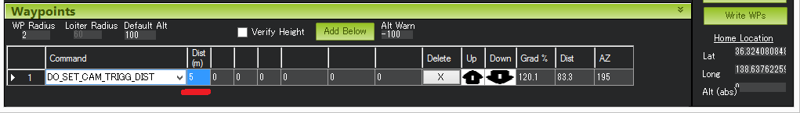

Trigger the :ref:`camera shutter <common-camera-shutter-with-servo>`
at regular distance intervals. For example the command above will cause
the camera shutter to trigger after every 5m that the vehicle travels.

**Dist (m)** - distance interval in meters.

**Trigger** - if "1", a picture is also taken immediately.

**Camera ID** - "0" applies the command to all cameras, "1" to the first camera, etc.

To stop the camera from triggering, add a DO_SET_CAM_TRIGG_DIST later in the mission with Dist = 0.

.. _mission-command-list_do-set-relay:

Do-Set-Relay
~~~~~~~~~~~~

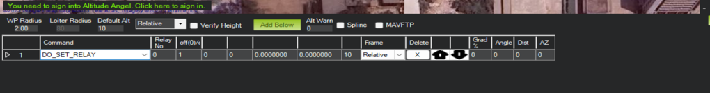

Set a :ref:`Relay <common-relay>` pin's voltage high or low.

**Relay No** : 0 = first relay (``RELAY1_`` parameters), 1 = second relay (``RELAY2_`` parameters), etc. The relay must have its ``RELAYn_FUNCTION`` (e.g. :ref:`RELAY1_FUNCTION<RELAY1_FUNCTION>`) set to 1 (Relay) and a valid ``RELAYn_PIN``, otherwise the command is ignored.

**off(0)/On(1)** : 0 = Off (i.e. 0V), 1 = On (i.e. 3.3V on
most autopilots), any other value toggles the relay. The output is reversed if ``RELAYn_INVERTED`` is 1.

Do-Repeat-Relay
~~~~~~~~~~~~~~~

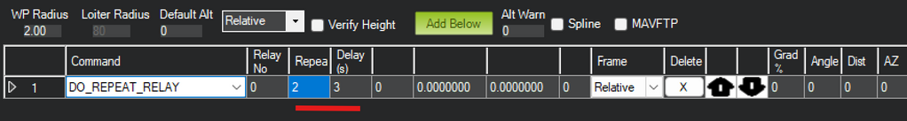

Toggle the :ref:`Relay <common-relay>` on and off a specified number of
times. In the example above, assuming the relay was off to begin with,
it would be turned on immediately, turned off after 1.5 seconds, turned on
again at 3 seconds and finally turned off at 4.5 seconds.

**First column is Relay number** : 0 = first relay, 1 = second relay, etc. The relay must be set up as described for Do-Set-Relay above.

**Repeat #** : number of on/off cycles (each cycle toggles the relay twice)

**Delay(s)** - the cycle time in seconds. The relay is toggled every half cycle.

Do-Set-Servo
~~~~~~~~~~~~

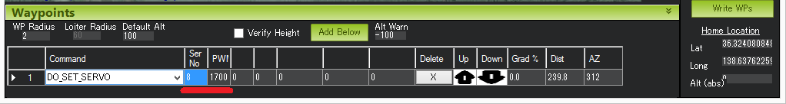

Move a :ref:`servo <common-servo>` to a particular PWM value. In the
example above, the servo attached to output channel 8 would be moved to
PWM 1700 (servos generally accept PWM values between 1000 and 2000).

**Ser No** : the output channel the servo is attached to (1 = SERVO1)

**PWM** : PWM value to output to the servo

The output's ``SERVOn_FUNCTION`` (e.g. :ref:`SERVO8_FUNCTION<SERVO8_FUNCTION>`) must be 0 (Disabled), 1 (RCPassThru), an RC input pass-through function (RCIN1 to RCIN16, or RCIN1Scaled to RCIN16Scaled), a sprayer or a gripper function. Otherwise the command is rejected with the message "ServoRelayEvent: Channel N is already in use".

Do-Repeat-Servo
~~~~~~~~~~~~~~~

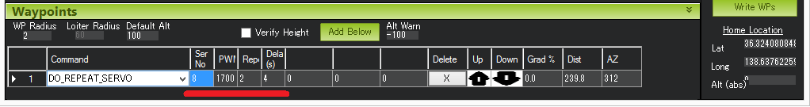

Repeatedly move a :ref:`servo <common-servo>` back and forth between
its trim position and a specified PWM value. In the example above, the
servo attached to output channel 8 would be moved to PWM 1700 immediately,
then after 2 seconds back to its trim value (held in the
:ref:`SERVO8_TRIM<SERVO8_TRIM>` parameter, normally 1500), after another 2 seconds it
would be moved to 1700 again, and after 2 more seconds it would be moved back
to trim.

**Ser No** : the output channel the servo is attached to (1 = SERVO1). The
same ``SERVOn_FUNCTION`` restrictions apply as for Do-Set-Servo above.

**PWM** : PWM value to output to the servo

**Repeat #** : Number of times to move the servo to the specified PWM
value

**Delay (s)** : the cycle time in seconds. The servo is held at the
specified PWM value for half of this time, and at its trim value for the
other half.

Do-Digicam-Control
~~~~~~~~~~~~~~~~~~

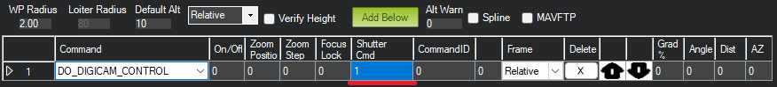

Trigger the :ref:`camera shutter <common-camera-shutter-with-servo>` once.  The "Shutter Cmd" field should be set to "1". Only the primary camera is triggered.

Do-Fence-Enable
~~~~~~~~~~~~~~~

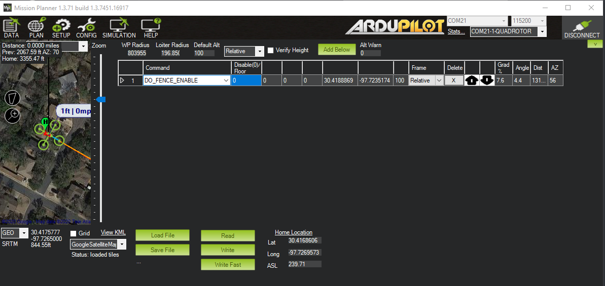

Enable (1) or disable (0) all of the fences configured in :ref:`FENCE_TYPE<FENCE_TYPE>` (see :ref:`common-geofencing-landing-page`). A value of 2 disables only the minimum altitude (floor) fence. Changes made by this command are not saved to :ref:`FENCE_ENABLE<FENCE_ENABLE>`.

Do-Gimbal-Manager-PitchYaw
~~~~~~~~~~~~~~~~~~~~~~~~~~

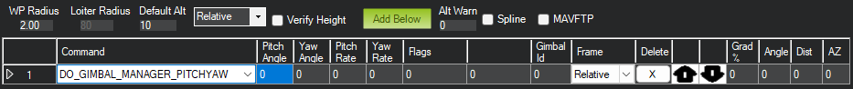

Moves the :ref:`camera gimbal <common-cameras-and-gimbals>` to the desired pitch and yaw angles (in degrees).  Positive pitch angles are up, Negative are down.  Positive yaw angles are clockwise, negative are counter clockwise.   If the "Flags" field is "0" the yaw angle is in "body frame" (e.g. 0 is forward).  If "Flags" is "16" the yaw angle is in "earth frame" (e.g. 0 is North).

If "Flags" is "1" the gimbal is retracted, and if it is "2" the gimbal is moved to its neutral position (the angle fields are then ignored). The "Gimbal ID" field selects the gimbal: 0 = primary, 1 = first, 2 = second.

Alternatively the gimbal can be moved at a rate (in deg/sec) using the Pitch Rate and Yaw Rate fields. The rate fields are only used if the pitch angle is set outside -90 to 90 (e.g. 100) or the yaw angle outside -360 to 360, otherwise the angle fields are used. The pitch angle and the rates are stored as whole numbers between -127 and 127, so rates are in whole deg/sec. The rotation stops automatically after 3 seconds, so angle targets are usually more useful in missions.

Do-Mount-Control
~~~~~~~~~~~~~~~~

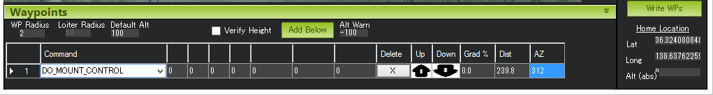

Controls the roll, pitch and yaw angle of the :ref:`camera gimbal <common-cameras-and-gimbals>`. This can be used to point the camera in specific directions at various times in the mission.

**Pitch, Roll, Yaw** - target angles in degrees (positive pitch is up). The yaw angle is relative to the vehicle's heading. If the gimbal cannot yaw, the vehicle itself is rotated by the yaw angle instead. Only the primary gimbal is controlled; use Do-Gimbal-Manager-PitchYaw to select a specific gimbal or to use an earth frame yaw angle.

Do-Gripper
~~~~~~~~~~

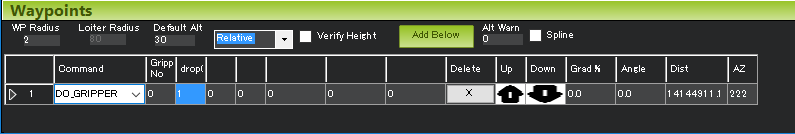

This command allows opening and closing a :ref:`servo gripper <common-gripper-servo>` or :ref:`EPM gripper <common-electro-permanent-magnet-gripper>`.
Set the "drop/grab" column to 0 to release (open) the gripper, or 1 to grab (close) it.  The first column, "Gripper No", is ignored because only a single gripper per vehicle is supported.

Do-Winch
~~~~~~~~

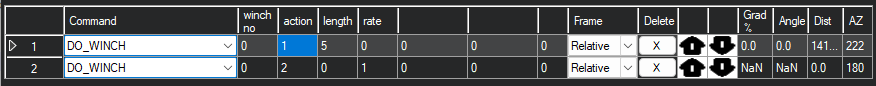

This command allows controlling a :ref:`winch <common-daiwa-winch>` to raise or lower a package.

- "winch no" is not used
- "action" should be 0 to relax the winch, 1 for Length control, 2 for Rate control
- "length" should be filled in with the meters of line to release, relative to the current line length.  Positive numbers release the line, negative retract the line.  Note "action" should be "1".
- "rate" should be filled in with the speed (in m/s) to release the line, limited to :ref:`WINCH_RATE_MAX<WINCH_RATE_MAX>`.  Positive numbers release the line, negative retract the line, and 0 stops the winch.  Note "action" should be "2".
