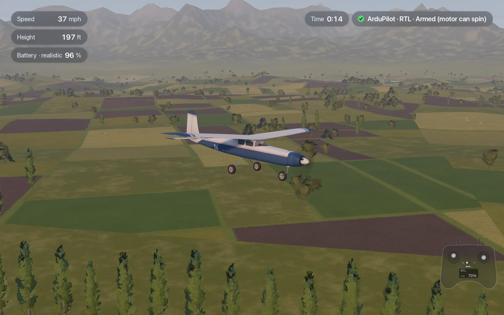

.. _sitl-with-flybefore:

==========================
Using SITL with Fly Before
==========================

`Fly Before <https://flybefore.com>`__ is an RC flight simulator for macOS that can be used as a physics backend for ArduPlane SITL through the :ref:`JSON interface <sitl-with-JSON>`. Fly Before provides the flight dynamics, the 3D view and the RC input, and ArduPlane runs next to it as a separate program that the simulator starts and stops for you.

   A trainer flown by ArduPlane SITL in Fly Before, in RTL

Fly Before runs on Apple Silicon Macs with macOS 13 or later. The simulator is a closed source commercial product. ArduPlane is not part of it: it is shipped in a separate free download, the *Fly Before ArduPilot Helper*, which is distributed under the GPLv3 together with the source code it was built from.

No build environment is needed, which makes this the quickest way to fly ArduPlane SITL on a Mac: the helper contains a prebuilt ArduPlane 4.7.2 SITL binary for Apple Silicon and one parameter file for each aircraft in the simulator, and the simulator starts it with one switch. It is meant for pilots who want to rehearse missions, failsafes and QuadPlane transitions with their own RC transmitter before the first flight of a real aircraft.

Supported Vehicles
==================

Only Plane is supported. Every aircraft in the simulator can be flown with ArduPlane, including two tilt-rotor QuadPlanes. Each aircraft has its own parameter file, which is loaded when the flight starts.

What Can Be Rehearsed
=====================

The following are covered by the simulator's automated tests against ArduPlane 4.7.2 SITL:

- FBWA and RTL
- automatic takeoff, waypoint missions in AUTO and automatic landing
- the RC, battery and geofence failsafes
- QuadPlane hover modes and the transition to forward flight and back

The simulator provides IMU, GPS position and velocity, airspeed, battery voltage and current, and wind to SITL. Rangefinders are not simulated.

How It Works
============

- Fly Before listens on UDP port 9002 and answers each servo packet from SITL with one JSON sensor frame, as described in :ref:`JSON interface <sitl-with-JSON>`.
- SITL runs in lockstep with the simulator. The physics advances by one step for each new frame from SITL, so pausing the simulator pauses ArduPlane too.
- The parameter files set ``SIM_RATE_HZ`` to 400 for fixed wing aircraft and to 1200 for the QuadPlanes, which need the higher rate to pass the gyro rate pre-arm check.
- RC input is sent to SITL in the ``rc`` field of the JSON frame, so a USB RC transmitter, gamepad or keyboard connected to the simulator is the RC input of ArduPlane. When the simulator stops sending the field, ArduPlane sees an RC failure, which is how the radio failsafe is rehearsed.
- Wind, gusts, thermals and slope lift from the simulator are sent in ``velocity_wind``.

Installation
============

#. Install Fly Before from `flybefore.com <https://flybefore.com>`__.
#. Download the *Fly Before ArduPilot Helper* from the `helper page <https://flybefore.com/helper/>`__ and open the zip. The source code archive is on the same page.
#. Move the **Fly Before ArduPilot Helper** folder into **Applications**, or next to Fly Before.

Flying with ArduPlane
=====================

#. In Fly Before, open **Settings**, then **Connections**, and turn on **Fly with ArduPilot**.
#. Choose an aircraft and press **Fly**. The simulator starts SITL with the parameter file of that aircraft.
#. Wait about 20 seconds until the status on screen changes from *Preparing* to a flight mode, for example *FBWA, disarmed*. This is the time SITL needs for a GPS fix and for the EKF to set its origin.
#. Arm with the throttle fully down and the rudder fully right for three seconds.

A six-position switch on RC channel 8 selects the flight mode:

+----------+------------+-----------+
| Position | Fixed wing | QuadPlane |
+==========+============+===========+
| 1        | FBWA       | QHOVER    |
+----------+------------+-----------+
| 2        | TAKEOFF    | QLOITER   |
+----------+------------+-----------+
| 3        | AUTO       | FBWA      |
+----------+------------+-----------+
| 4        | RTL        | QRTL      |
+----------+------------+-----------+
| 5        | LOITER     | QLAND     |
+----------+------------+-----------+
| 6        | MANUAL     | CRUISE    |
+----------+------------+-----------+

The RC failsafe, the battery failsafe and the geofence are enabled in the parameter files and behave as they do on a real aircraft.

SITL is stopped when the flight ends. Each armed flight leaves a dataflash log (``.BIN``) that can be opened in UAV Log Viewer or Mission Planner.

Connecting a Ground Station
===========================

SITL sends MAVLink to UDP port 14550 on the same machine. QGroundControl listens on that port by default, so it connects on its own when it is opened during a flight.

For a ground station that connects over TCP, such as Mission Planner on another computer or a tablet on the same network, use TCP port 5765. TCP port 5760 is used by the simulator itself to upload lesson missions, and SITL accepts only one client on it.

Parameters can be read and written, missions uploaded and downloaded, and modes changed from the ground station. Parameters changed from a ground station are saved when the flight ends and loaded again the next time the same aircraft is flown. They can be reset to the original file from the **Connections** screen.

Limitations
===========

- The helper is available for Apple Silicon Macs only.
- Only Plane is supported. Copter, Rover and Sub cannot be flown.
- Automatic takeoff, missions and landing are tested on two of the fixed wing aircraft. QuadPlane missions have not been verified in the same way.
- The parameter files are tuned for the flight model of the simulator. Trim, airspeed and PID values should not be copied to a real aircraft. Do the tuning on the aircraft itself.
- Rangefinders and terrain data are not provided to SITL.

Troubleshooting
===============

If the status stays on *Preparing*, check on the **Connections** screen that the helper was found, and point the simulator at the helper folder if it was not.

If a lesson reports that TCP port 5760 is in use, another program is connected to it. Connect that program to TCP port 5765 or UDP port 14550 instead.

If QGroundControl does not connect on its own, restart it during the flight, or add a UDP link on port 14550 under **Application Settings**, **Comm Links**.
