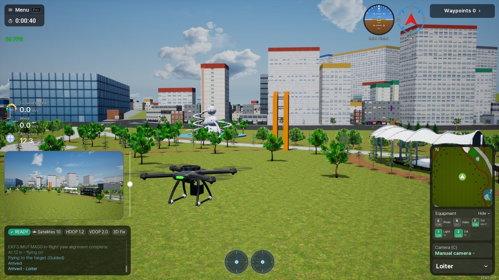
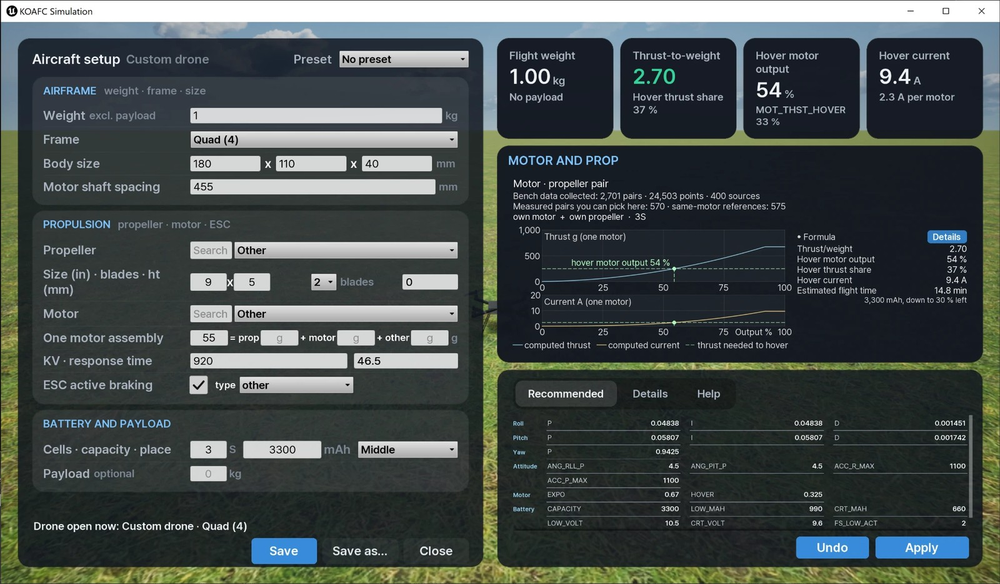
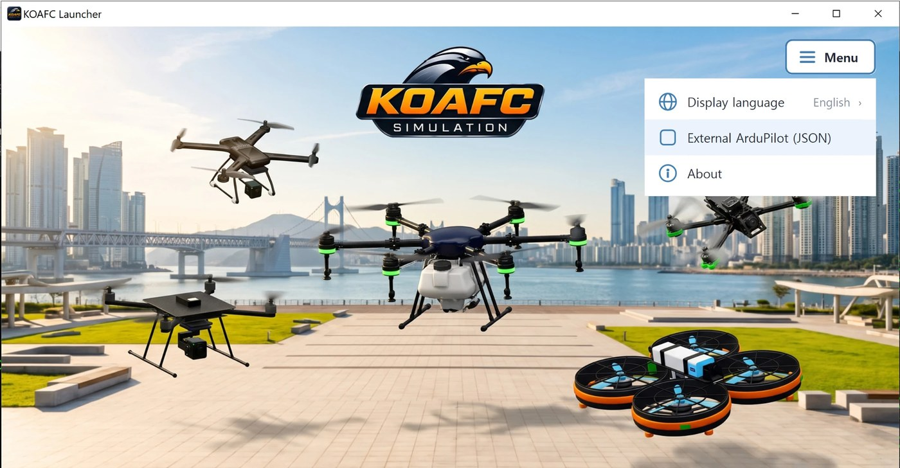
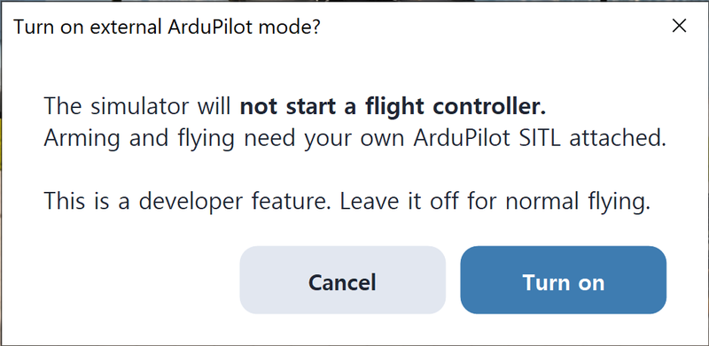
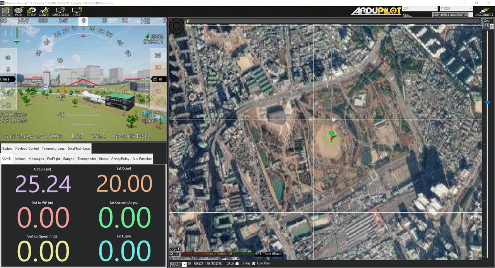

.. _sitl-with-koafc:

================================
Using SITL with KOAFC Simulation
================================

`KOAFC Simulation <https://koafc.com/simulation/?lang=en>`__ is a multicopter flight simulator for Windows built on
Unreal Engine 4 (on a modified AirSim). It is used for drone pilot licence training and agricultural spraying practice,
and has maps built from real places, survey and spraying payloads, simulated rangefinders and a 360° lidar.

The simulator normally starts its own bundled ArduCopter SITL. In developer mode it starts none and is used as a
physics backend for **your** SITL (your own branch, on Linux, WSL2 or another PC) through the
:ref:`JSON interface <sitl-with-JSON>`: KOAFC Simulation provides the flight dynamics, the 3D scene and the simulated
sensors, and ArduPilot runs as the flight controller.

   A quadcopter flown by ArduPilot SITL in KOAFC Simulation

KOAFC Simulation is closed source. The bundled ArduCopter SITL is built from ArduPilot with KOAFC's small changes, and
its source is published at `koadrone/koafc-simulation-sitl <https://github.com/koadrone/koafc-simulation-sitl>`__.

Editions
========

KOAFC Simulation is commercial, closed-source software. A free account is needed; the Free edition (personal,
non-commercial use) includes the JSON interface, ground stations and ROS 2 over MAVLink, and the seven mission maps. See
`koafc.com/simulation <https://koafc.com/simulation/?lang=en>`__ for editions.

Development for a company or an institution counts as commercial use and needs the Basic or Pro edition.

In JSON mode your ground station and ROS 2 / MAVROS connect to your own SITL as usual (MAVProxy's outputs). In the
normal mode the simulator's bundled SITL offers MAVLink on UDP 14550 for a ground station, and a ROS 2 host set in
``preferences.json`` gets SERIAL2, in every edition.

Maps
----

The maps include a real city park (Busan Citizens Park), a coast and harbour, paddy fields, facility and tunnel
inspection sites, a survey site, FPV racing tracks (day and night) and an indoor gym, and custom maps of real places can be
built from any address. See `koafc.com/simulation <https://koafc.com/simulation/?lang=en>`__ for the full list.

Mission maps
------------

Seven mission maps with work orders - spraying, inspection, search and rescue and survey - are included in every
edition.

Supported Vehicles
==================

Multicopters in X configuration: quad and hexa airframes (F450-class, racing, hexa); octa (planned). The custom airframe, whose size,
motors, propellers and battery can be edited, is a Pro feature (a 5-day trial in the Free and Basic editions). Fixed
wing aircraft are not supported in this mode.

The custom airframe editor computes thrust, hover throttle and current from motor and propeller bench data and
recommends starting parameters (rate and angle gains, ``MOT_THST_HOVER``, ``MOT_THST_EXPO`` and the battery failsafes). In
JSON mode its **Apply** button sends them to the attached SITL over MAVLink and writes them into the airframe's parameter
file, which can be given to a new SITL with ``--add-param-file`` (see below).

   The custom airframe editor with its recommended parameters

Simulated sensors sent to SITL: IMU, GPS position and velocity, attitude, and rangefinders 1 to 6.

Installation
============

#. Sign up and download the launcher from `koafc.com/simulation <https://koafc.com/simulation/?lang=en>`__.
#. Install it and let it download the simulator.

Setting Up the Simulator
========================

With the simulator closed, open the launcher's **Menu** and tick **External ArduPilot (JSON)**. The launcher
asks to confirm ("Turn on external ArduPilot mode?") - the simulator will then not start a flight controller, and arming
and flying need your own ArduPilot SITL attached. Untick the same switch to return to the normal mode; that also
removes the two optional keys below. Windows Firewall may ask to allow the simulator the first time.

   The launcher's Menu with the External ArduPilot (JSON) switch

   The confirmation shown when turning it on

The switch writes ``"sitl_link": "json"`` into ``CustomConfig\preferences.json`` in the simulator's folder
(``%LOCALAPPDATA%\Programs\KOAFC_Simulation\Environments\KOAFC_Simulation_Engine\WindowsNoEditor\KOAFC_Simulation_Engine\``).
Two more keys can be added there by hand, with the simulator closed, when SITL runs on another PC or needs another port:

.. code-block:: json

    "json_sitl_bind": "0.0.0.0",
    "json_sitl_port": 9002

``json_sitl_bind`` can be left out when SITL runs on the same PC; ``json_sitl_port`` is the servo port (default 9002).

Start a flight. An orange **External ArduPilot** tag is shown on the selection screen, and in flight the status card shows
"Waiting for external ArduPilot" with the UDP port until SITL connects. The simulator writes the exact command to use,
with the map's home location, into its log ``AppData\LocalLow\KOAFC_Simulation\engine.log`` (lines starting with
``[KOAFC-JSON]``). When SITL connects, the message "External ArduPilot attached (<address>)" appears once its start-up
messages are done, and the usual READY indication follows when SITL's EKF is using GPS.

At every flight start the simulator also writes a parameter file for the chosen airframe,
``AppData\LocalLow\KOAFC_Simulation\SITL\json\<airframe>.param``. It sets ``FRAME_TYPE 1``, the motor outputs and the
tuning, and switches off the sensors the JSON interface cannot carry (rangefinders 7 to 10, ``PRXn_TYPE 12``).

Starting SITL
=============

.. code-block:: bash

    sim_vehicle.py -v ArduCopter -f X --model JSON:<simulator PC IP> \
        -l <lat>,<lon>,<alt>,0 \
        --add-param-file=<copy of the airframe .param file> \
        --out=udp:<simulator PC IP>:14552 --out=udp:<simulator PC IP>:14557

- ``-f X`` for a quad (sim_vehicle's ``quad`` is a plus frame); ``-f hexa`` with the airframe's parameter file for the
  hexacopter.
- ``-l`` is the map's home from the ``[KOAFC-JSON]`` log line.
- The simulator's on-screen display, flight modes, missions and arming checks read MAVLink on UDP 14552, and the EKF
  status on UDP 14557. Your ground station gets MAVProxy's usual outputs.
- Use instance 0 (``-I0``); SITL sends its servo packets to port 9002 + 10 x instance.
- If ``json_sitl_port`` was changed, add ``-A "--sim-port-out=<port>"`` with the same port, since SITL sends its
  servo packets to 9002 otherwise.

The transmitter, gamepad or keyboard connected to the simulator reaches SITL inside the JSON packet (``rc_1`` to
``rc_12``), so no RC setup is needed. SITL can be restarted during a flight; the simulator follows the new instance
within a few seconds, clears the previous instance's status and waits for the new one's EKF before READY.

A SITL started with ``-w`` (fresh parameters) refuses to arm for the first 20 to 40 seconds with
"Arm: Gyros inconsistent" while its gyros settle.

Camera Video
============

The simulator can send the aircraft's camera picture to a ground station, as from a real aircraft: turn on **Video out**
in the simulator's settings. It sends H.264 in MPEG-TS over UDP to port 5600 on the simulator's PC (640 x 480, 30 fps;
``"video_fps"`` in ``preferences.json`` lowers the rate). The **Video out** help in the simulator shows the settings below,
each with a **Copy** button.

- QGroundControl: Application Settings, Video, Source "MPEG-TS Video Stream", UDP URL ``0.0.0.0:5600``.
- Mission Planner: Data tab, right-click the HUD, Video, Set GStreamer Source:

  .. code-block:: none

      udpsrc port=5600 ! tsdemux ! h264parse ! avdec_h264 ! videoconvert ! video/x-raw,format=BGRA ! appsink name=outsink sync=false

   The simulator's camera video in Mission Planner's HUD

To receive the video on another PC (for example the one running SITL or ROS 2), add ``"ros_out_host": "<that PC's IP>"``
to ``preferences.json``; the stream is then also sent there (port ``"ros_out_video_port"``, default 5600).

Limitations
===========

Compared with the simulator's normal mode, the JSON interface does not carry rotor RPM (ESC telemetry), the 360°
lidar point cloud or rangefinders 7 to 10. The simulator does not load parameters into SITL when it starts and does
not save the values SITL reports; from the simulator's side, parameters reach SITL only through the airframe's
parameter file or the custom airframe editor's **Apply** (your ground station can set them as usual).
