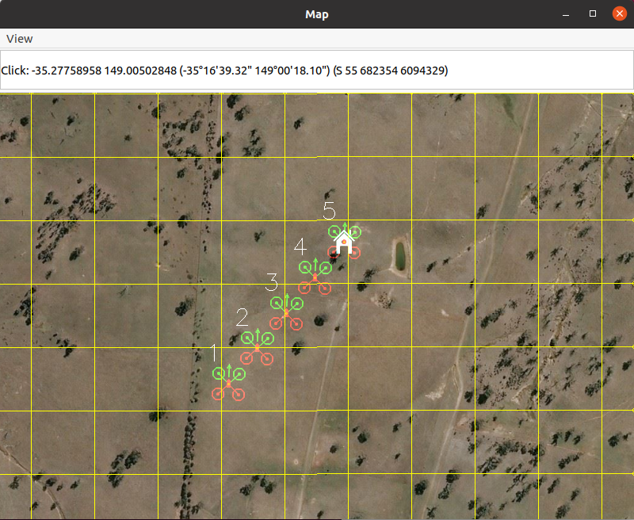

.. _multi:

===============================
Multiple Vehicles with MAVProxy
===============================

MAVProxy has support for multi-vehicle operations.

To use this feature, ensure all vehicles (real or SITL) have different :ref:`MAV_SYSID<copter:MAV_SYSID>` parameter values (``SYSID_THISMAV`` in firmware 4.6 and earlier). Use ``param set MAV_SYSID X`` to set this value in the MAVProxy console (where ``X`` is the id).

Most MAVProxy modules are designed to talk to only 1 vehicle at a time. This is the active vehicle. To change which vehicle is active, use the Vehicle dropdown menu on the graphical console. All modules will then send any relevant commands to that vehicle only.

In the terminal, there are two options available:

* Use ``alllinks <cmd>`` to send <cmd> to all vehicles in turn. For example, ``alllinks mode rtl`` will set RTL mode on all vehicles.
* Use ``vehicle <n>`` to set the active vehicle

See the :ref:`swarm module <mavproxy-modules-swarm>` for a GUI for automating swarm management and operations.
