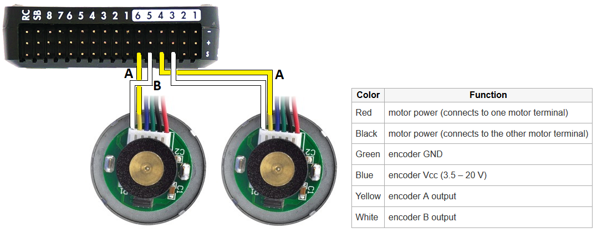
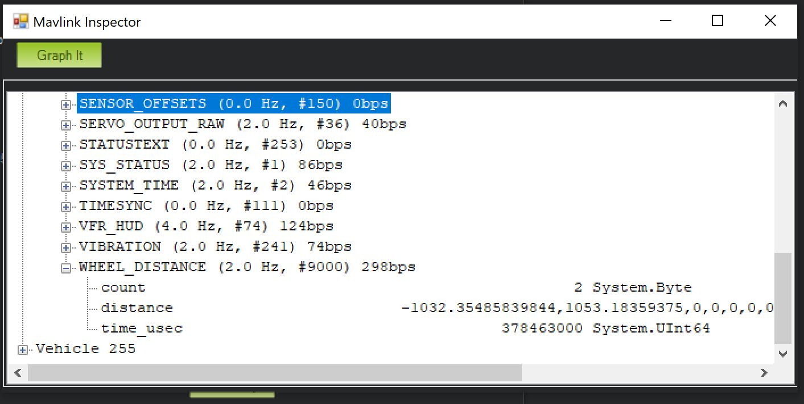

.. _wheel-encoder:

==============
Wheel Encoders
==============

Rover supports up to four wheel encoders (two on autopilots with 1MB of flash or less) which can be used to improve position estimation especially when no GPS is used.  Encoders can either be "AB" encoders like those in `this Pololu motor <https://www.pololu.com/product/1442>`__ connected directly to the autopilot, or encoders read by an external board, such as a companion computer or motor controller, which sends the readings to the autopilot using MAVLink.

.. note:: MAVLink wheel encoders and more than two wheel encoders are supported in ArduPilot 4.8 and later.  MAVLink wheel encoders are not included by default on autopilots with 1MB of flash or less, but can be added using the `custom firmware build server <https://custom.ardupilot.org>`__.

..  youtube:: eaLBRx7LYD8
    :width: 100%

Connection and Setup
====================

AB Encoders Connected to the Autopilot
--------------------------------------

- connect motor encoder's A and B outputs to the autopilot (A Pixhawk using AUX OUT 3,4,5 and 6 pins is shown for example above).
- set those output's ``SERVOx_FUNCTION`` to -1 to allow them to be used as GPIO inputs. See :ref:`common-gpios` for more information. For the example above, set :ref:`SERVO11_FUNCTION<SERVO11_FUNCTION>`, :ref:`SERVO12_FUNCTION<SERVO12_FUNCTION>`, :ref:`SERVO13_FUNCTION<SERVO13_FUNCTION>`, and :ref:`SERVO14_FUNCTION<SERVO14_FUNCTION>` to "-1".
- set :ref:`WENC_TYPE <WENC_TYPE>` and :ref:`WENC2_TYPE <WENC2_TYPE>` to 1 to enable reading from two wheel encoders
- set :ref:`WENC_CPR <WENC_CPR>` and :ref:`WENC2_CPR <WENC2_CPR>` to the counts-per-revolution of the encoder.  This is the number of "pings" the encoder will produce for each full revolution of the wheel
- disable :ref:`relays <common-relay>` by setting :ref:`RELAY1_PIN <RELAY1_PIN>` and :ref:`RELAY2_PIN <RELAY2_PIN>` to -1

MAVLink Encoders
----------------

- the external board should send the `WHEEL_DISTANCE <https://mavlink.io/en/messages/common.html#WHEEL_DISTANCE>`__ message, holding the total distance in meters travelled by each wheel since startup.  Forward rotation increases the distance, reverse rotation decreases it.
- the board must use the same MAVLink system ID as the autopilot (any component ID may be used).  ``WHEEL_DISTANCE`` messages from other system IDs, such as other vehicles on the same network, are ignored.
- send the message at a regular rate of at least 5Hz.  Readings more than 0.5 seconds apart are treated as a gap in the data and are not used, and an encoder which has received nothing for 0.5 seconds is reported as unhealthy.
- set :ref:`WENC_TYPE <WENC_TYPE>` and :ref:`WENC2_TYPE <WENC2_TYPE>` to 2 ("MAVLink").  The first encoder reads ``distance[0]`` of the message, the second reads ``distance[1]`` and so on, so the board and the autopilot must agree which wheel is at each index.
- leave :ref:`WENC_CPR <WENC_CPR>` and :ref:`WENC2_CPR <WENC2_CPR>` at their defaults.  The autopilot uses these internally to store the distance received.

Wheel Radius and Position
-------------------------

- set :ref:`WENC_RADIUS <WENC_RADIUS>` and :ref:`WENC2_RADIUS <WENC2_RADIUS>` to the radius (in meters) of each wheel (i.e. 5cm radius would be 0.05).  This is required for MAVLink encoders too, to calculate each wheel's rotation rate.
- set :ref:`WENC_POS_X <WENC_POS_X>` and :ref:`WENC_POS_Y <WENC_POS_Y>` to define the first wheel's distance from the autopilot or COG (i.e. :ref:`WENC_POS_X <WENC_POS_X>` = 0.10, :ref:`WENC_POS_Y <WENC_POS_Y>` = -0.05 means the wheel is 10cm ahead and 5cm left of the autopilot)
- set :ref:`WENC2_POS_X <WENC2_POS_X>` and :ref:`WENC2_POS_Y <WENC2_POS_Y>` to define the second wheel's distance from the autopilot or COG

Using More Than Two Encoders
----------------------------

A vehicle with one encoder per side only needs the first two encoders.  For a vehicle with an encoder on each of four wheels, also set the ``WENC3_`` and ``WENC4_`` parameters for the third and fourth wheels in the same way as above.  All configured encoders are used for position estimation.

:ref:`Wheel rate control <balance_bot-tuning-wrc>` only uses the first two encoders, as the left and right sides of the vehicle.

EKF Setup
---------

To enable position estimation using the wheel encoders the EKF3 must be used and configured as follows:

- set :ref:`AHRS_EKF_TYPE <AHRS_EKF_TYPE>` to 3 (means use EKF3)
- set :ref:`EK2_ENABLE <EK2_ENABLE>` to 0 (disable EKF2)
- set :ref:`EK3_ENABLE <EK3_ENABLE>` to 1 (enable EKF3)
- set :ref:`EK3_SRC1_VELXY <EK3_SRC1_VELXY>` to 7 ("WheelEncoder")
- (optionally) set :ref:`EK3_SRC1_POSXY <EK3_SRC1_POSXY>` to 0 ("None") to disable use of GPS for horizontal position
- (optionally) set :ref:`EK3_SRC1_VELZ <EK3_SRC1_VELZ>` to 0 ("None") to disable use of GPS for vertical velocity

After making the above changes the autopilot should be rebooted

Ground Testing
==============

The ``WHEEL_DISTANCE`` MAVLink message shows the total distance travelled by each wheel in real time.  Mission Planner's MAVLink Inspector can be used which can be opened by pressing Ctrl-F and then pushing the "MAVLink Inspector" button.

Wheel Rate Control
==================

For Balance bots, the wheel encoders can also be used to close a rate-control loop around each side's throttle output.  See :ref:`here for more details <balance_bot-tuning-wrc>`.

DataFlash logging
=================

The wheel encoder data including total distance travelled by each wheel appears in the WENC dataflash log messages, as ``Dist0`` for the first wheel, ``Dist1`` for the second and so on.  ``Dist2`` and ``Dist3`` are available in ArduPilot 4.8 and later.
